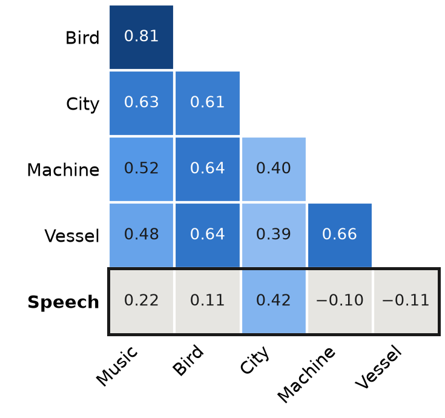
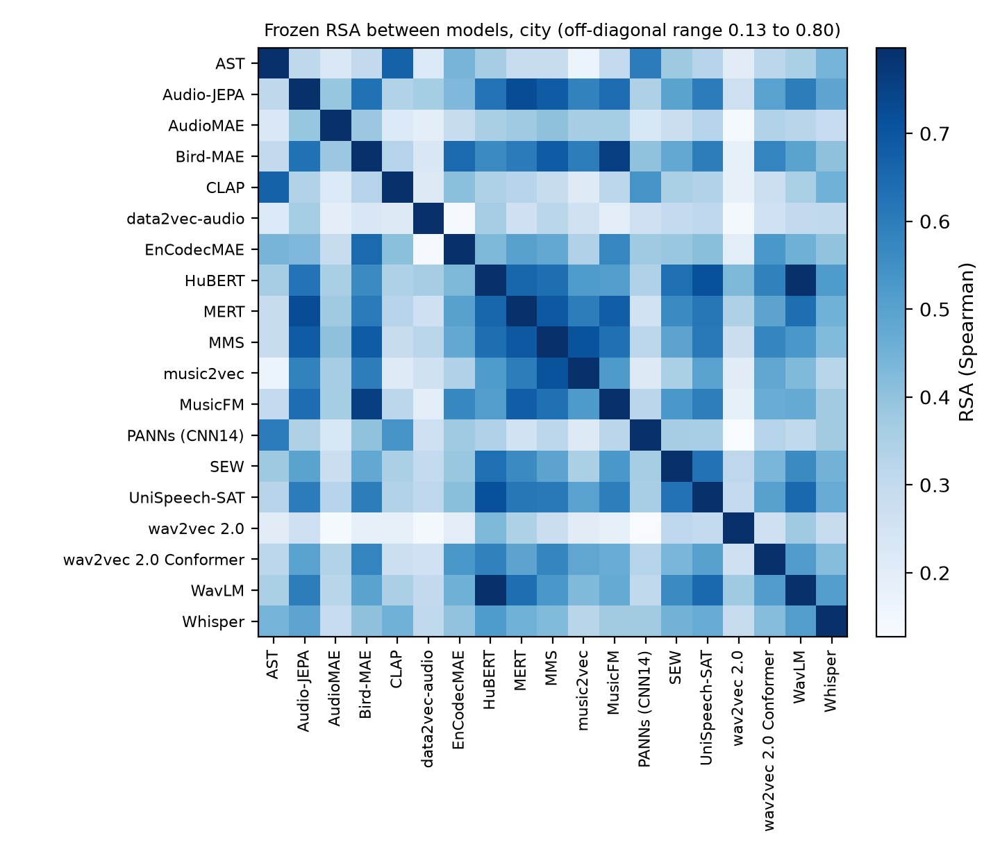

# ECHO: appendix

This appendix accompanies the paper. Every table below is generated by `scripts/paper/make_appendix.py` from the aggregate results in `results/`; the analysis code is in `scripts/paper/` and the experimental specification (datasets, splits, hyper-parameters, metrics, statistical tests) is in [`REPRODUCIBILITY.md`](REPRODUCIBILITY.md). Vessel results are aggregate statistics only; no vessel audio, labels or per-model vessel values are released.

## Contents

A. Model roster and checkpoints  
B. Frozen and adapted accuracy (converged probe)  
C. Frozen usability probes and geometry (Finding 2)  
D. Cross-domain stability and taxonomy tests (Finding 1)  
E. Adaptation gain analyses (Finding 3)  
F. How adaptation reshapes geometry (Finding 3)  
G. Frozen RSA matrices

## A. Model roster and checkpoints

Pretrained checkpoints used for every model (Hugging Face identifiers unless stated). No adapted weights are distributed: the adaptation pipeline stores only clip × clip RDM and Gram matrices (§4 of REPRODUCIBILITY.md).

| model                 | training paradigm                     |   params (M) | adaptation   | checkpoint                                                                       |
|:----------------------|:--------------------------------------|-------------:|:-------------|:---------------------------------------------------------------------------------|
| AST                   | Supervised/discriminative             |         86.2 | LoRA, ALLoRA | MIT/ast-finetuned-audioset-10-10-0.4593                                          |
| Audio-JEPA            | Joint-embedding and self-distillation |         85.4 | top-K        | ltuncay/Audio-JEPA, JEPA.ckpt                                                    |
| AudioMAE              | Masked modeling and reconstruction    |        111.7 | top-K        | facebookresearch/AudioMAE, pretrained.pth (ViT-B/16, README-linked Google Drive) |
| Bird-MAE              | Masked modeling and reconstruction    |         85.5 | LoRA, ALLoRA | DBD-research-group/Bird-MAE-Base                                                 |
| CLAP                  | Cross-modal contrastive               |        193.9 | LoRA, ALLoRA | laion/larger_clap_general                                                        |
| data2vec-audio        | Joint-embedding and self-distillation |         93.2 | LoRA, ALLoRA | facebook/data2vec-audio-base                                                     |
| EnCodecMAE            | Masked modeling and reconstruction    |        100.6 | frozen only  | habla-liaa/encodecmae, model ec-ec-large_st                                      |
| HuBERT                | Masked modeling and reconstruction    |        315.4 | LoRA, ALLoRA | facebook/hubert-large-ll60k                                                      |
| MERT                  | Masked modeling and reconstruction    |        315.4 | LoRA, ALLoRA | m-a-p/MERT-v1-330M                                                               |
| MMS                   | Masked modeling and reconstruction    |        315.4 | LoRA, ALLoRA | facebook/mms-300m                                                                |
| music2vec             | Joint-embedding and self-distillation |         93.2 | LoRA, ALLoRA | m-a-p/music2vec-v1                                                               |
| MusicFM               | Masked modeling and reconstruction    |        328.9 | top-K        | minzwon/MusicFM, pretrained_msd.pt                                               |
| PANNs (CNN14)         | Supervised/discriminative             |         81.8 | top-K        | Zenodo 3987831, Cnn14_mAP=0.431.pth                                              |
| SEW                   | Masked modeling and reconstruction    |         40.7 | LoRA, ALLoRA | asapp/sew-tiny-100k                                                              |
| UniSpeech-SAT         | Masked modeling and reconstruction    |         94.4 | LoRA, ALLoRA | microsoft/unispeech-sat-base                                                     |
| wav2vec 2.0           | Masked modeling and reconstruction    |        315.4 | LoRA, ALLoRA | facebook/wav2vec2-large-lv60                                                     |
| wav2vec 2.0 Conformer | Masked modeling and reconstruction    |        618.6 | LoRA, ALLoRA | facebook/wav2vec2-conformer-rel-pos-large                                        |
| WavLM                 | Masked modeling and reconstruction    |         94.4 | LoRA, ALLoRA | microsoft/wavlm-base-plus                                                        |
| Whisper               | Supervised/discriminative             |         20.6 | LoRA, ALLoRA | openai/whisper-base                                                              |

## B. Frozen and adapted accuracy (converged probe)

Test accuracy of the converged linear probe on Gram-recovered features of the frozen and the adapted encoder, mean ± SD over seeds. Primary condition: LoRA for the 14 LoRA-eligible models, top-K for the other 4. Gain = adapted − frozen (primary condition). City LoRA excludes WavLM (incomplete adapted checkpoints); speech LoRA misses some seeds.

| domain   | model                 |   seeds | frozen        | adapted (primary)     |   gain (primary) | adapted (ALLoRA)   |
|:---------|:----------------------|--------:|:--------------|:----------------------|-----------------:|:-------------------|
| music    | AST                   |       5 | 0.526 ± 0.000 | 0.535 ± 0.012 (LoRA)  |            0.009 | 0.534 ± 0.010      |
| music    | Audio-JEPA            |       5 | 0.456 ± 0.000 | 0.432 ± 0.009 (top-K) |           -0.024 |                    |
| music    | AudioMAE              |       5 | 0.439 ± 0.000 | 0.423 ± 0.013 (top-K) |           -0.016 |                    |
| music    | Bird-MAE              |       5 | 0.428 ± 0.000 | 0.449 ± 0.012 (LoRA)  |            0.021 | 0.447 ± 0.007      |
| music    | CLAP                  |       5 | 0.556 ± 0.000 | 0.553 ± 0.008 (LoRA)  |           -0.003 | 0.555 ± 0.006      |
| music    | data2vec-audio        |       5 | 0.338 ± 0.000 | 0.385 ± 0.029 (LoRA)  |            0.048 | 0.389 ± 0.018      |
| music    | HuBERT                |       5 | 0.393 ± 0.000 | 0.392 ± 0.013 (LoRA)  |           -0.000 | 0.390 ± 0.019      |
| music    | MERT                  |       5 | 0.439 ± 0.000 | 0.473 ± 0.014 (LoRA)  |            0.034 | 0.480 ± 0.023      |
| music    | MMS                   |       5 | 0.436 ± 0.000 | 0.418 ± 0.020 (LoRA)  |           -0.018 | 0.428 ± 0.014      |
| music    | music2vec             |       5 | 0.459 ± 0.000 | 0.517 ± 0.009 (LoRA)  |            0.058 | 0.530 ± 0.007      |
| music    | MusicFM               |       5 | 0.507 ± 0.000 | 0.458 ± 0.005 (top-K) |           -0.050 |                    |
| music    | PANNs (CNN14)         |       5 | 0.500 ± 0.000 | 0.512 ± 0.015 (top-K) |            0.012 |                    |
| music    | SEW                   |       5 | 0.375 ± 0.000 | 0.403 ± 0.014 (LoRA)  |            0.028 | 0.387 ± 0.007      |
| music    | UniSpeech-SAT         |       5 | 0.370 ± 0.000 | 0.414 ± 0.015 (LoRA)  |            0.044 | 0.412 ± 0.016      |
| music    | wav2vec 2.0           |       5 | 0.395 ± 0.000 | 0.401 ± 0.019 (LoRA)  |            0.006 | 0.423 ± 0.017      |
| music    | wav2vec 2.0 Conformer |       5 | 0.384 ± 0.000 | 0.371 ± 0.014 (LoRA)  |           -0.013 | 0.388 ± 0.017      |
| music    | WavLM                 |       5 | 0.390 ± 0.000 | 0.406 ± 0.011 (LoRA)  |            0.016 | 0.404 ± 0.013      |
| music    | Whisper               |       5 | 0.466 ± 0.000 | 0.476 ± 0.014 (LoRA)  |            0.009 | 0.466 ± 0.011      |
| city     | AST                   |       5 | 0.805 ± 0.000 | 0.842 ± 0.010 (LoRA)  |            0.037 | 0.848 ± 0.009      |
| city     | Audio-JEPA            |       5 | 0.604 ± 0.000 | 0.648 ± 0.012 (top-K) |            0.045 |                    |
| city     | AudioMAE              |       5 | 0.695 ± 0.000 | 0.804 ± 0.012 (top-K) |            0.109 |                    |
| city     | Bird-MAE              |       5 | 0.762 ± 0.000 | 0.791 ± 0.015 (LoRA)  |            0.029 | 0.800 ± 0.017      |
| city     | CLAP                  |       5 | 0.836 ± 0.000 | 0.833 ± 0.006 (LoRA)  |           -0.003 | 0.824 ± 0.012      |
| city     | data2vec-audio        |       5 | 0.481 ± 0.000 | 0.604 ± 0.026 (LoRA)  |            0.123 | 0.557 ± 0.022      |
| city     | HuBERT                |       5 | 0.620 ± 0.000 | 0.667 ± 0.020 (LoRA)  |            0.048 | 0.659 ± 0.017      |
| city     | MERT                  |       5 | 0.588 ± 0.000 | 0.742 ± 0.014 (LoRA)  |            0.155 | 0.721 ± 0.024      |
| city     | MMS                   |       5 | 0.621 ± 0.000 | 0.674 ± 0.009 (LoRA)  |            0.053 | 0.667 ± 0.022      |
| city     | music2vec             |       5 | 0.509 ± 0.000 | 0.663 ± 0.016 (LoRA)  |            0.154 | 0.662 ± 0.009      |
| city     | MusicFM               |       5 | 0.676 ± 0.000 | 0.653 ± 0.005 (top-K) |           -0.023 |                    |
| city     | PANNs (CNN14)         |       5 | 0.764 ± 0.000 | 0.808 ± 0.007 (top-K) |            0.044 |                    |
| city     | SEW                   |       5 | 0.596 ± 0.000 | 0.675 ± 0.013 (LoRA)  |            0.079 | 0.673 ± 0.032      |
| city     | UniSpeech-SAT         |       5 | 0.630 ± 0.000 | 0.682 ± 0.021 (LoRA)  |            0.052 | 0.697 ± 0.037      |
| city     | wav2vec 2.0           |       5 | 0.644 ± 0.000 | 0.605 ± 0.021 (LoRA)  |           -0.039 | 0.622 ± 0.018      |
| city     | wav2vec 2.0 Conformer |       5 | 0.615 ± 0.000 | 0.647 ± 0.017 (LoRA)  |            0.032 | 0.645 ± 0.012      |
| city     | WavLM                 |       5 | 0.643 ± 0.000 | excluded              |                  | 0.632 ± 0.028      |
| city     | Whisper               |       5 | 0.731 ± 0.000 | 0.749 ± 0.032 (LoRA)  |            0.018 | 0.716 ± 0.012      |
| bird     | AST                   |       5 | 0.322 ± 0.000 | 0.442 ± 0.014 (LoRA)  |            0.120 | 0.445 ± 0.013      |
| bird     | Audio-JEPA            |       5 | 0.181 ± 0.000 | 0.103 ± 0.018 (top-K) |           -0.077 |                    |
| bird     | AudioMAE              |       5 | 0.232 ± 0.000 | 0.435 ± 0.015 (top-K) |            0.203 |                    |
| bird     | Bird-MAE              |       5 | 0.298 ± 0.000 | 0.390 ± 0.033 (LoRA)  |            0.092 | 0.360 ± 0.021      |
| bird     | CLAP                  |       5 | 0.339 ± 0.000 | 0.446 ± 0.012 (LoRA)  |            0.107 | 0.419 ± 0.021      |
| bird     | data2vec-audio        |       5 | 0.119 ± 0.000 | 0.127 ± 0.006 (LoRA)  |            0.008 | 0.155 ± 0.009      |
| bird     | HuBERT                |       5 | 0.253 ± 0.000 | 0.316 ± 0.005 (LoRA)  |            0.064 | 0.321 ± 0.013      |
| bird     | MERT                  |       5 | 0.191 ± 0.000 | 0.312 ± 0.018 (LoRA)  |            0.121 | 0.299 ± 0.018      |
| bird     | MMS                   |       5 | 0.248 ± 0.000 | 0.322 ± 0.011 (LoRA)  |            0.074 | 0.327 ± 0.029      |
| bird     | music2vec             |       5 | 0.142 ± 0.000 | 0.189 ± 0.014 (LoRA)  |            0.047 | 0.174 ± 0.015      |
| bird     | MusicFM               |       5 | 0.207 ± 0.000 | 0.194 ± 0.003 (top-K) |           -0.013 |                    |
| bird     | PANNs (CNN14)         |       5 | 0.264 ± 0.000 | 0.403 ± 0.032 (top-K) |            0.139 |                    |
| bird     | SEW                   |       5 | 0.202 ± 0.000 | 0.247 ± 0.012 (LoRA)  |            0.044 | 0.244 ± 0.014      |
| bird     | UniSpeech-SAT         |       5 | 0.219 ± 0.000 | 0.286 ± 0.023 (LoRA)  |            0.067 | 0.295 ± 0.015      |
| bird     | wav2vec 2.0           |       5 | 0.232 ± 0.000 | 0.228 ± 0.015 (LoRA)  |           -0.004 | 0.234 ± 0.014      |
| bird     | wav2vec 2.0 Conformer |       5 | 0.225 ± 0.000 | 0.261 ± 0.009 (LoRA)  |            0.035 | 0.260 ± 0.024      |
| bird     | WavLM                 |       5 | 0.284 ± 0.000 | 0.279 ± 0.018 (LoRA)  |           -0.004 | 0.244 ± 0.026      |
| bird     | Whisper               |       5 | 0.288 ± 0.000 | 0.310 ± 0.026 (LoRA)  |            0.023 | 0.293 ± 0.023      |
| speech   | AST                   |       4 | 0.961 ± 0.000 | 0.998 ± 0.001 (LoRA)  |            0.037 | 0.997 ± 0.001      |
| speech   | Audio-JEPA            |       5 | 0.848 ± 0.000 | 0.867 ± 0.003 (top-K) |            0.019 |                    |
| speech   | AudioMAE              |       5 | 0.757 ± 0.000 | 0.987 ± 0.003 (top-K) |            0.229 |                    |
| speech   | Bird-MAE              |       4 | 0.992 ± 0.000 | 0.988 ± 0.003 (LoRA)  |           -0.004 | 0.988 ± 0.002      |
| speech   | CLAP                  |       4 | 0.995 ± 0.000 | 0.998 ± 0.001 (LoRA)  |            0.003 | 0.998 ± 0.001      |
| speech   | data2vec-audio        |       4 | 0.701 ± 0.000 | 0.972 ± 0.002 (LoRA)  |            0.271 | 0.967 ± 0.007      |
| speech   | HuBERT                |       4 | 0.955 ± 0.000 | 0.999 ± 0.000 (LoRA)  |            0.044 | 0.999 ± 0.000      |
| speech   | MERT                  |       4 | 0.936 ± 0.000 | 0.998 ± 0.001 (LoRA)  |            0.062 | 0.997 ± 0.001      |
| speech   | MMS                   |       2 | 0.985 ± 0.000 | 1.000 ± 0.000 (LoRA)  |            0.015 | 0.999 ± 0.000      |
| speech   | music2vec             |       3 | 0.732 ± 0.000 | 0.845 ± 0.027 (LoRA)  |            0.114 | 0.841 ± 0.013      |
| speech   | MusicFM               |       5 | 0.981 ± 0.000 | 0.972 ± 0.001 (top-K) |           -0.008 |                    |
| speech   | PANNs (CNN14)         |       4 | 0.779 ± 0.000 | 0.980 ± 0.003 (top-K) |            0.201 |                    |
| speech   | SEW                   |       3 | 0.968 ± 0.000 | 0.992 ± 0.001 (LoRA)  |            0.024 | 0.989 ± 0.002      |
| speech   | UniSpeech-SAT         |       3 | 0.987 ± 0.000 | 0.999 ± 0.000 (LoRA)  |            0.012 | 0.998 ± 0.001      |
| speech   | wav2vec 2.0           |       4 | 0.970 ± 0.000 | 0.908 ± 0.076 (LoRA)  |           -0.062 | 0.878 ± 0.048      |
| speech   | wav2vec 2.0 Conformer |       3 | 0.987 ± 0.000 | 0.991 ± 0.002 (LoRA)  |            0.005 | 0.992 ± 0.003      |
| speech   | WavLM                 |       4 | 0.968 ± 0.000 | 0.987 ± 0.002 (LoRA)  |            0.019 | 0.983 ± 0.001      |
| speech   | Whisper               |       3 | 0.979 ± 0.000 | 0.966 ± 0.005 (LoRA)  |           -0.013 | 0.972 ± 0.006      |
| machine  | AST                   |       5 | 0.513 ± 0.000 | 0.498 ± 0.021 (LoRA)  |           -0.015 | 0.512 ± 0.031      |
| machine  | Audio-JEPA            |       5 | 0.483 ± 0.000 | 0.433 ± 0.024 (top-K) |           -0.050 |                    |
| machine  | AudioMAE              |       5 | 0.475 ± 0.000 | 0.476 ± 0.009 (top-K) |            0.001 |                    |
| machine  | Bird-MAE              |       5 | 0.465 ± 0.000 | 0.510 ± 0.039 (LoRA)  |            0.045 | 0.466 ± 0.028      |
| machine  | CLAP                  |       5 | 0.510 ± 0.000 | 0.524 ± 0.033 (LoRA)  |            0.014 | 0.523 ± 0.035      |
| machine  | data2vec-audio        |       5 | 0.547 ± 0.000 | 0.488 ± 0.018 (LoRA)  |           -0.058 | 0.494 ± 0.038      |
| machine  | HuBERT                |       5 | 0.453 ± 0.000 | 0.495 ± 0.029 (LoRA)  |            0.041 | 0.477 ± 0.027      |
| machine  | MERT                  |       5 | 0.483 ± 0.000 | 0.470 ± 0.022 (LoRA)  |           -0.013 | 0.498 ± 0.026      |
| machine  | MMS                   |       5 | 0.483 ± 0.000 | 0.494 ± 0.040 (LoRA)  |            0.011 | 0.519 ± 0.023      |
| machine  | music2vec             |       5 | 0.485 ± 0.000 | 0.484 ± 0.039 (LoRA)  |           -0.001 | 0.497 ± 0.044      |
| machine  | MusicFM               |       5 | 0.515 ± 0.000 | 0.502 ± 0.006 (top-K) |           -0.013 |                    |
| machine  | PANNs (CNN14)         |       5 | 0.503 ± 0.000 | 0.487 ± 0.020 (top-K) |           -0.016 |                    |
| machine  | SEW                   |       5 | 0.532 ± 0.000 | 0.540 ± 0.020 (LoRA)  |            0.009 | 0.512 ± 0.031      |
| machine  | UniSpeech-SAT         |       5 | 0.593 ± 0.000 | 0.542 ± 0.032 (LoRA)  |           -0.051 | 0.526 ± 0.019      |
| machine  | wav2vec 2.0           |       5 | 0.543 ± 0.000 | 0.484 ± 0.058 (LoRA)  |           -0.059 | 0.492 ± 0.027      |
| machine  | wav2vec 2.0 Conformer |       5 | 0.468 ± 0.000 | 0.517 ± 0.024 (LoRA)  |            0.049 | 0.508 ± 0.017      |
| machine  | WavLM                 |       5 | 0.500 ± 0.000 | 0.520 ± 0.051 (LoRA)  |            0.020 | 0.458 ± 0.024      |
| machine  | Whisper               |       5 | 0.468 ± 0.000 | 0.483 ± 0.012 (LoRA)  |            0.015 | 0.471 ± 0.032      |

## C. Frozen usability probes and geometry (Finding 2)

Linear: logistic regression (C = 1) on standardized frozen embeddings; linear (converged): the same model run to convergence, used for the kNN − linear gap; kNN: k = 10. Geometry columns are computed on each domain's full pool.

| domain   | model                 |   n_test |   linear |   linear (converged) |   knn |   uniformity |   alignment |   TwoNN |
|:---------|:----------------------|---------:|---------:|---------------------:|------:|-------------:|------------:|--------:|
| bird     | AST                   |     1499 |    0.442 |                0.468 | 0.354 |       -1.843 |       0.843 |  10.928 |
| bird     | Audio-JEPA            |     1499 |    0.196 |                0.178 | 0.086 |       -0.111 |       0.055 |   7.907 |
| bird     | AudioMAE              |     1499 |    0.282 |                0.282 | 0.161 |       -0.098 |       0.048 |  10.758 |
| bird     | Bird-MAE              |     1499 |    0.454 |                0.442 | 0.307 |       -0.108 |       0.046 |   9.298 |
| bird     | CLAP                  |     1499 |    0.322 |                0.333 | 0.226 |       -1.586 |       0.732 |   9.781 |
| bird     | data2vec-audio        |     1499 |    0.106 |                0.113 | 0.090 |       -0.520 |       0.468 |  11.406 |
| bird     | EnCodecMAE            |     1499 |    0.286 |                0.308 | 0.192 |       -1.036 |       0.487 |   7.404 |
| bird     | HuBERT                |     1499 |    0.337 |                0.360 | 0.241 |       -0.745 |       0.378 |  12.457 |
| bird     | MERT                  |     1499 |    0.292 |                0.298 | 0.201 |       -0.704 |       0.351 |   7.517 |
| bird     | MMS                   |     1499 |    0.350 |                0.352 | 0.184 |       -0.064 |       0.028 |   8.531 |
| bird     | music2vec             |     1499 |    0.151 |                0.171 | 0.109 |       -0.596 |       0.296 |  20.033 |
| bird     | MusicFM               |     1499 |    0.295 |                0.293 | 0.150 |       -1.330 |       0.641 |  11.499 |
| bird     | PANNs (CNN14)         |     1499 |    0.317 |                0.334 | 0.243 |       -0.927 |       0.419 |   9.550 |
| bird     | SEW                   |     1499 |    0.254 |                0.262 | 0.181 |       -0.282 |       0.129 |   6.746 |
| bird     | UniSpeech-SAT         |     1499 |    0.243 |                0.254 | 0.188 |       -1.692 |       0.852 |  12.159 |
| bird     | wav2vec 2.0           |     1499 |    0.243 |                0.259 | 0.152 |       -0.014 |       0.007 |  10.654 |
| bird     | wav2vec 2.0 Conformer |     1499 |    0.256 |                0.269 | 0.179 |       -0.761 |       0.384 |  15.921 |
| bird     | WavLM                 |     1499 |    0.318 |                0.329 | 0.209 |       -1.047 |       0.531 |   9.280 |
| bird     | Whisper               |     1499 |    0.362 |                0.368 | 0.195 |       -0.028 |       0.013 |  10.311 |
| city     | AST                   |      873 |    0.835 |                0.855 | 0.844 |       -2.172 |       0.836 |   6.183 |
| city     | Audio-JEPA            |      873 |    0.656 |                0.661 | 0.551 |       -0.196 |       0.079 |   7.736 |
| city     | AudioMAE              |      873 |    0.733 |                0.731 | 0.612 |       -0.170 |       0.079 |  10.709 |
| city     | Bird-MAE              |      873 |    0.785 |                0.809 | 0.773 |       -0.173 |       0.065 |   7.803 |
| city     | CLAP                  |      873 |    0.816 |                0.811 | 0.802 |       -2.491 |       0.916 |   7.191 |
| city     | data2vec-audio        |      873 |    0.480 |                0.495 | 0.384 |       -0.522 |       0.348 |  10.730 |
| city     | EnCodecMAE            |      873 |    0.698 |                0.688 | 0.641 |       -1.472 |       0.637 |   5.530 |
| city     | HuBERT                |      873 |    0.661 |                0.679 | 0.617 |       -0.823 |       0.400 |  11.869 |
| city     | MERT                  |      873 |    0.683 |                0.687 | 0.593 |       -1.048 |       0.484 |   6.395 |
| city     | MMS                   |      873 |    0.652 |                0.651 | 0.656 |       -0.250 |       0.123 |   7.086 |
| city     | music2vec             |      873 |    0.560 |                0.552 | 0.471 |       -0.972 |       0.529 |  17.076 |
| city     | MusicFM               |      873 |    0.711 |                0.738 | 0.665 |       -1.548 |       0.699 |   8.742 |
| city     | PANNs (CNN14)         |      873 |    0.789 |                0.803 | 0.755 |       -1.485 |       0.541 |   6.032 |
| city     | SEW                   |      873 |    0.623 |                0.625 | 0.526 |       -0.237 |       0.095 |   5.885 |
| city     | UniSpeech-SAT         |      873 |    0.620 |                0.622 | 0.603 |       -1.773 |       0.847 |  10.260 |
| city     | wav2vec 2.0           |      873 |    0.685 |                0.695 | 0.550 |       -0.020 |       0.014 |  10.172 |
| city     | wav2vec 2.0 Conformer |      873 |    0.651 |                0.662 | 0.551 |       -0.955 |       0.489 |  15.968 |
| city     | WavLM                 |      873 |    0.643 |                0.648 | 0.613 |       -1.177 |       0.560 |   8.866 |
| city     | Whisper               |      873 |    0.686 |                0.722 | 0.656 |       -0.037 |       0.014 |   9.612 |
| machine  | AST                   |      480 |    0.927 |                0.935 | 0.921 |       -1.804 |       1.043 |  12.449 |
| machine  | Audio-JEPA            |      480 |    0.854 |                0.856 | 0.781 |       -0.110 |       0.056 |   8.822 |
| machine  | AudioMAE              |      480 |    0.940 |                0.944 | 0.917 |       -0.102 |       0.051 |  11.007 |
| machine  | Bird-MAE              |      480 |    0.908 |                0.917 | 0.850 |       -0.089 |       0.045 |  12.749 |
| machine  | CLAP                  |      480 |    0.894 |                0.896 | 0.885 |       -1.045 |       0.566 |  10.595 |
| machine  | data2vec-audio        |      480 |    0.740 |                0.752 | 0.698 |       -0.397 |       0.309 |   8.182 |
| machine  | EnCodecMAE            |      480 |    0.933 |                0.950 | 0.894 |       -0.700 |       0.380 |   8.491 |
| machine  | HuBERT                |      480 |    0.825 |                0.833 | 0.829 |       -0.554 |       0.314 |  11.069 |
| machine  | MERT                  |      480 |    0.952 |                0.956 | 0.873 |       -0.348 |       0.180 |   8.741 |
| machine  | MMS                   |      480 |    0.927 |                0.929 | 0.858 |       -0.037 |       0.018 |   8.435 |
| machine  | music2vec             |      480 |    0.840 |                0.840 | 0.854 |       -0.662 |       0.352 |  12.065 |
| machine  | MusicFM               |      480 |    0.927 |                0.929 | 0.890 |       -0.702 |       0.368 |  10.133 |
| machine  | PANNs (CNN14)         |      480 |    0.887 |                0.877 | 0.871 |       -0.964 |       0.537 |  10.100 |
| machine  | SEW                   |      480 |    0.848 |                0.854 | 0.810 |       -0.131 |       0.067 |   6.072 |
| machine  | UniSpeech-SAT         |      480 |    0.863 |                0.871 | 0.808 |       -1.263 |       0.718 |   9.890 |
| machine  | wav2vec 2.0           |      480 |    0.863 |                0.867 | 0.754 |       -0.003 |       0.002 |   7.630 |
| machine  | WavLM                 |      480 |    0.881 |                0.883 | 0.825 |       -0.783 |       0.453 |   8.074 |
| machine  | Whisper               |      480 |    0.873 |                0.877 | 0.844 |       -0.025 |       0.012 |  11.350 |
| music    | AST                   |      800 |    0.476 |                0.468 | 0.539 |       -2.491 |       1.163 |  22.262 |
| music    | Audio-JEPA            |      800 |    0.427 |                0.431 | 0.376 |       -0.691 |       0.334 |  14.899 |
| music    | AudioMAE              |      800 |    0.441 |                0.445 | 0.407 |       -0.331 |       0.164 |  24.299 |
| music    | Bird-MAE              |      800 |    0.436 |                0.427 | 0.432 |       -0.142 |       0.064 |  26.523 |
| music    | CLAP                  |      800 |    0.546 |                0.542 | 0.588 |       -2.603 |       1.188 |  16.273 |
| music    | data2vec-audio        |      800 |    0.334 |                0.326 | 0.321 |       -0.777 |       0.574 |  16.532 |
| music    | EnCodecMAE            |      800 |    0.491 |                0.484 | 0.466 |       -1.333 |       0.635 |  18.359 |
| music    | HuBERT                |      800 |    0.417 |                0.414 | 0.338 |       -0.678 |       0.345 |  23.737 |
| music    | MERT                  |      800 |    0.420 |                0.422 | 0.383 |       -0.711 |       0.337 |  22.044 |
| music    | MMS                   |      800 |    0.430 |                0.435 | 0.393 |       -0.032 |       0.015 |  24.077 |
| music    | music2vec             |      800 |    0.438 |                0.432 | 0.451 |       -0.698 |       0.331 |  26.189 |
| music    | MusicFM               |      800 |    0.479 |                0.468 | 0.495 |       -1.426 |       0.699 |  26.470 |
| music    | PANNs (CNN14)         |      800 |    0.446 |                0.448 | 0.497 |       -1.465 |       0.653 |  16.521 |
| music    | SEW                   |      800 |    0.388 |                0.393 | 0.338 |       -0.189 |       0.088 |  16.402 |
| music    | UniSpeech-SAT         |      800 |    0.396 |                0.403 | 0.315 |       -1.329 |       0.680 |  24.813 |
| music    | wav2vec 2.0           |      800 |    0.361 |                0.362 | 0.343 |       -0.007 |       0.003 |  16.238 |
| music    | wav2vec 2.0 Conformer |      800 |    0.385 |                0.383 | 0.321 |       -0.866 |       0.450 |  25.371 |
| music    | WavLM                 |      800 |    0.399 |                0.410 | 0.325 |       -0.983 |       0.489 |  21.419 |
| music    | Whisper               |      800 |    0.445 |                0.435 | 0.439 |       -0.080 |       0.034 |  22.813 |
| speech   | AST                   |     1505 |    0.927 |                0.966 | 0.795 |       -1.183 |       0.376 |  18.304 |
| speech   | Audio-JEPA            |     1505 |    0.760 |                0.823 | 0.353 |       -0.261 |       0.152 |  13.283 |
| speech   | AudioMAE              |     1505 |    0.640 |                0.716 | 0.274 |       -0.306 |       0.133 |  21.930 |
| speech   | Bird-MAE              |     1505 |    0.969 |                0.989 | 0.897 |       -0.065 |       0.019 |  20.288 |
| speech   | CLAP                  |     1505 |    0.981 |                0.992 | 0.968 |       -2.081 |       0.455 |  13.775 |
| speech   | data2vec-audio        |     1505 |    0.708 |                0.783 | 0.443 |       -0.266 |       0.258 |  37.959 |
| speech   | EnCodecMAE            |     1505 |    0.997 |                0.999 | 0.997 |       -1.109 |       0.149 |  17.387 |
| speech   | HuBERT                |     1505 |    0.935 |                0.977 | 0.869 |       -2.010 |       0.782 |  25.853 |
| speech   | MERT                  |     1505 |    0.938 |                0.965 | 0.902 |       -0.353 |       0.144 |  13.839 |
| speech   | MMS                   |     1505 |    0.965 |                0.991 | 0.898 |       -0.040 |       0.018 |  14.009 |
| speech   | music2vec             |     1505 |    0.754 |                0.775 | 0.601 |       -0.551 |       0.349 |  26.776 |
| speech   | MusicFM               |     1505 |    0.952 |                0.970 | 0.873 |       -0.559 |       0.212 |  19.615 |
| speech   | PANNs (CNN14)         |     1505 |    0.728 |                0.774 | 0.494 |       -0.468 |       0.173 |  18.360 |
| speech   | SEW                   |     1505 |    0.938 |                0.963 | 0.858 |       -0.059 |       0.017 |  13.572 |
| speech   | UniSpeech-SAT         |     1505 |    0.963 |                0.976 | 0.885 |       -0.560 |       0.243 |  20.907 |
| speech   | wav2vec 2.0           |     1505 |    0.958 |                0.980 | 0.666 |       -0.018 |       0.009 |  11.050 |
| speech   | wav2vec 2.0 Conformer |     1505 |    0.926 |                0.981 | 0.723 |       -0.356 |       0.150 |  16.057 |
| speech   | WavLM                 |     1505 |    0.924 |                0.962 | 0.811 |       -0.585 |       0.327 |  24.377 |
| speech   | Whisper               |     1505 |    0.897 |                0.955 | 0.456 |       -0.062 |       0.028 |  31.013 |

Summary statistics (`finding2.py`):

| statistic                                              | value                  |
|:-------------------------------------------------------|:-----------------------|
| sign_test_ratio_ast_clap_higher                        | 5/5                    |
| sign_test_ratio_ast_clap_p_two_sided                   | 0.0625                 |
| sign_test_ratio_all_supervised_contrastive_higher      | 4/5                    |
| sign_test_ratio_all_supervised_contrastive_p_two_sided | 0.375                  |
| bird_birdmae_over_audiomae_linear                      | 1.6073706591070163     |
| bird_birdmae_over_audiomae_knn                         | 1.908582089552239      |
| bird_birdmae_minus_audiomae_linear                     | 0.1714                 |
| bird_birdmae_minus_audiomae_knn                        | 0.1461                 |
| music_birdmae_over_audiomae_linear                     | 0.9888939256572984     |
| music_birdmae_over_audiomae_knn                        | 1.0613496932515338     |
| music_birdmae_minus_audiomae_linear                    | -0.00489999999999996   |
| music_birdmae_minus_audiomae_knn                       | 0.025000000000000022   |
| machine_birdmae_over_audiomae_linear                   | 0.9666879523201363     |
| machine_birdmae_over_audiomae_knn                      | 0.927239009490564      |
| machine_birdmae_minus_audiomae_linear                  | -0.031299999999999994  |
| machine_birdmae_minus_audiomae_knn                     | -0.06669999999999998   |
| n_rows                                                 | 94                     |
| rho_uniformity_knn                                     | -0.3580155043613905    |
| p_uniformity_knn                                       | 0.00039584130534752463 |
| rho_uniformity_gap                                     | -0.37486544088429724   |
| p_uniformity_gap                                       | 0.00019723588711395023 |
| partial_rho_uniformity_knn_given_logparams             | -0.34099627930498866   |
| partial_p                                              | 0.0007703186076812216  |
| vif_uniformity_logparams                               | 1.0170405222408834     |

kNN/linear accuracy ratio by domain:

| domain   | best_discriminative_model   |   its_rank_linear |   its_rank_knn |   ratio_ast_clap |   ratio_all_supervised_contrastive |   ratio_reconstruction |
|:---------|:----------------------------|------------------:|---------------:|-----------------:|-----------------------------------:|-----------------------:|
| bird     | ast                         |             2.000 |          1.000 |            0.752 |                              0.702 |                  0.652 |
| music    | clap                        |             1.000 |          1.000 |            1.103 |                              1.077 |                  0.899 |
| speech   | clap                        |             2.000 |          2.000 |            0.922 |                              0.758 |                  0.857 |
| machine  | ast                         |             5.000 |          1.000 |            0.992 |                              0.983 |                  0.944 |
| city     | ast                         |             1.000 |          1.000 |            0.997 |                              0.977 |                  0.909 |

## D. Cross-domain stability and taxonomy tests (Finding 1)

Spearman ρ between two domains' 19 × 19 frozen RSA matrices (171 model pairs), one-sided model-identity permutation test (10,000 permutations), BH over the 15 pairs. LOO: range of ρ when each model is removed.

| domain A   | domain B   |     rho |   p_perm |   q_bh |   loo_min |   loo_max | model whose removal gives the minimum   |
|:-----------|:-----------|--------:|---------:|-------:|----------:|----------:|:----------------------------------------|
| music      | bird       |  0.8148 |   0.0001 | 0.0004 |    0.7770 |    0.8779 | data2vec_audio                          |
| city       | bird       |  0.6141 |   0.0001 | 0.0004 |    0.5255 |    0.6737 | data2vec_audio                          |
| bird       | machine    |  0.6379 |   0.0001 | 0.0004 |    0.5804 |    0.7602 | music2vec                               |
| bird       | vessel     |  0.6443 |   0.0001 | 0.0004 |    0.5362 |    0.7227 | data2vec_audio                          |
| music      | city       |  0.6271 |   0.0002 | 0.0005 |    0.5542 |    0.6831 | data2vec_audio                          |
| machine    | vessel     |  0.6585 |   0.0002 | 0.0005 |    0.5663 |    0.7213 | music2vec                               |
| music      | machine    |  0.5166 |   0.0015 | 0.0032 |    0.4631 |    0.6436 | wav2vec2                                |
| music      | vessel     |  0.4751 |   0.0036 | 0.0067 |    0.3248 |    0.5678 | data2vec_audio                          |
| city       | vessel     |  0.3857 |   0.0131 | 0.0199 |    0.2584 |    0.4572 | data2vec_audio                          |
| city       | speech     |  0.4161 |   0.0133 | 0.0199 |    0.3671 |    0.4923 | hubert                                  |
| city       | machine    |  0.3993 |   0.0146 | 0.0199 |    0.2541 |    0.4970 | wav2vec2                                |
| music      | speech     |  0.2181 |   0.1260 | 0.1575 |    0.0879 |    0.3170 | audiomae                                |
| bird       | speech     |  0.1056 |   0.2678 | 0.3090 |   -0.0439 |    0.2199 | audiomae                                |
| speech     | machine    | -0.0997 |   0.6794 | 0.7032 |   -0.1858 |    0.0265 | wav2vec2                                |
| speech     | vessel     | -0.1061 |   0.7032 | 0.7032 |   -0.1616 |   -0.0502 | musicfm                                 |

Leave-one-model-out with BH within each roster (5,000 permutations): no removal makes a speech pair significant; removing AST or wav2vec 2.0 drops city–machine below significance and removing data2vec-audio drops city–vessel; every other removal leaves all 11 pairs significant (`results/finding1/cross_domain_leave_one_out.txt`).

Taxonomy alignment: Mantel r between each domain's RSA matrix and a same-group indicator, one-sided permutation p (200,000 permutations), 95% bootstrap CI over models. None of the 12 tests survives BH at q = 0.05.

| domain   | taxonomy        |   n_models |   mantel_r |   p_perm |   ci_lo |   ci_hi | bh_survives   |
|:---------|:----------------|-----------:|-----------:|---------:|--------:|--------:|:--------------|
| City     | domain+paradigm |         19 |     0.2728 |   0.0295 | -0.0012 |  0.5875 | False         |
| City     | breadth         |         19 |     0.0453 |   0.3076 | -0.1911 |  0.3789 | False         |
| Speech   | domain+paradigm |         19 |     0.3108 |   0.0216 |  0.0843 |  0.5434 | False         |
| Speech   | breadth         |         19 |     0.0981 |   0.1732 | -0.2117 |  0.4443 | False         |
| Music    | domain+paradigm |         19 |     0.2853 |   0.0207 | -0.0264 |  0.6137 | False         |
| Music    | breadth         |         19 |     0.2002 |   0.0256 | -0.0847 |  0.5403 | False         |
| Bird     | domain+paradigm |         19 |     0.1707 |   0.1075 | -0.0841 |  0.4915 | False         |
| Bird     | breadth         |         19 |     0.2360 |   0.0108 | -0.0201 |  0.5335 | False         |
| Vessel   | domain+paradigm |         19 |     0.1680 |   0.1419 | -0.1040 |  0.4626 | False         |
| Vessel   | breadth         |         19 |     0.2160 |   0.0252 | -0.0895 |  0.5357 | False         |
| Machine  | domain+paradigm |         19 |    -0.0046 |   0.4964 | -0.2564 |  0.3600 | False         |
| Machine  | breadth         |         19 |     0.2021 |   0.0322 | -0.0891 |  0.5131 | False         |

Group definitions (`audio_comp/pipelines/breadth_hypothesis_check.py`; models not listed form singleton groups):

| grouping              | group                          | models                                                                                |
|:----------------------|:-------------------------------|:--------------------------------------------------------------------------------------|
| domain + paradigm     | masked_modeling_speech         | HuBERT, wav2vec 2.0, WavLM, UniSpeech-SAT, SEW, wav2vec 2.0 Conformer, MMS            |
| domain + paradigm     | masked_modeling_music          | MERT, MusicFM                                                                         |
| domain + paradigm     | data2vec_music                 | music2vec                                                                             |
| domain + paradigm     | data2vec_speech                | data2vec-audio                                                                        |
| domain + paradigm     | contrastive_general            | CLAP                                                                                  |
| domain + paradigm     | jepa_general                   | Audio-JEPA                                                                            |
| domain + paradigm     | reconstruction_bioacoustic     | Bird-MAE                                                                              |
| domain + paradigm     | supervised_cnn_general         | PANNs (CNN14)                                                                         |
| domain + paradigm     | supervised_transformer_general | AST                                                                                   |
| domain + paradigm     | reconstruction_general         | AudioMAE                                                                              |
| domain + paradigm     | supervised_asr_speech          | Whisper                                                                               |
| domain + paradigm     | masked_codec_general           | EnCodecMAE                                                                            |
| training-data breadth | narrow_speech                  | HuBERT, wav2vec 2.0, WavLM, data2vec-audio, UniSpeech-SAT, SEW, wav2vec 2.0 Conformer |
| training-data breadth | narrow_music                   | MERT, MusicFM                                                                         |
| training-data breadth | narrow_bioacoustic             | Bird-MAE                                                                              |
| training-data breadth | broad_mixed                    | Audio-JEPA, CLAP, PANNs (CNN14), AST, AudioMAE, EnCodecMAE                            |
| training-data breadth | broad_speech                   | MMS, Whisper                                                                          |
| training-data breadth | self_distillation_narrow_music | music2vec                                                                             |

## E. Adaptation gain analyses (Finding 3)

Regression gain ~ difficulty + uniformity + domain match (model-clustered SE; R² CI and within-domain ρ CI from 2,000 model bootstraps):

| variant                                |   n_rows |   n_models |     R2 |   b_difficulty |   b_uniformity |   b_domain_match |   se_difficulty |   se_uniformity |   se_domain_match |   p_difficulty |   p_uniformity |   p_domain_match |   R2_ci_lo |   R2_ci_hi |   within_rho |   within_rho_ci_lo |   within_rho_ci_hi |   n_pairs |
|:---------------------------------------|---------:|-----------:|-------:|---------------:|---------------:|-----------------:|----------------:|----------------:|------------------:|---------------:|---------------:|-----------------:|-----------:|-----------:|-------------:|-------------------:|-------------------:|----------:|
| all public domains                     |      423 |         18 | 0.0784 |         0.0642 |         0.0031 |          -0.0164 |          0.0272 |          0.0107 |            0.0239 |         0.0307 |         0.7792 |           0.5008 |     0.0217 |     0.2187 |      -0.0248 |            -0.3331 |             0.2435 |   89.0000 |
| without machine                        |      333 |         18 | 0.0187 |         0.0323 |         0.0052 |          -0.0150 |          0.0297 |          0.0121 |            0.0231 |         0.2925 |         0.6713 |           0.5245 |   nan      |   nan      |     nan      |           nan      |           nan      |  nan      |
| speech complete seeds only             |      390 |         18 | 0.0751 |         0.0637 |         0.0019 |          -0.0124 |          0.0254 |          0.0099 |            0.0209 |         0.0226 |         0.8508 |           0.5617 |   nan      |   nan      |     nan      |           nan      |           nan      |  nan      |
| (model, domain) pairs with all 5 seeds |      370 |         18 | 0.0918 |         0.0761 |         0.0031 |           0.0025 |          0.0317 |          0.0108 |            0.0265 |         0.0280 |         0.7744 |           0.9250 |   nan      |   nan      |     nan      |           nan      |           nan      |  nan      |

Predictor search (leave-one-model-out CV R², permutation p over the full search, 2,000 permutations):

| target      | pool                      |   n_pairs |   uniformity_alone_cv_r2 | best                                       |   best_cv_r2 |   perm_p |   p_bonferroni_6 | second                                |   second_cv_r2 | third                                      |   third_cv_r2 |
|:------------|:--------------------------|----------:|-------------------------:|:-------------------------------------------|-------------:|---------:|-----------------:|:--------------------------------------|---------------:|:-------------------------------------------|--------------:|
| gain        | frozen, label-free        |        88 |                  -0.0815 | twonn                                      |      -0.0186 |   0.4293 |           1.0000 | twonn + domain_match                  |        -0.0323 | uniformity + alignment + twonn             |       -0.0435 |
| gain        | frozen, incl. label-using |        88 |                  -0.0815 | discriminative + linear + frozen_acc       |       0.2583 |   0.0030 |           0.0180 | discriminative + frozen_acc           |         0.2561 | domain_match + discriminative + frozen_acc |        0.2425 |
| gain        | incl. post-hoc d_uni      |        88 |                  -0.0815 | discriminative + linear + frozen_acc       |       0.2583 |   0.0060 |           0.0360 | discriminative + frozen_acc           |         0.2561 | domain_match + discriminative + frozen_acc |        0.2425 |
| adapted_acc | frozen, label-free        |        88 |                   0.0228 | uniformity + domain_match + discriminative |       0.1998 |   0.0130 |           0.0780 | twonn + domain_match + discriminative |         0.1973 | domain_match + discriminative              |        0.1972 |
| adapted_acc | frozen, incl. label-using |        88 |                   0.0228 | discriminative + linear + frozen_acc       |       0.4261 |   0.0005 |           0.0030 | discriminative + frozen_acc           |         0.4244 | domain_match + discriminative + frozen_acc |        0.4139 |
| adapted_acc | incl. post-hoc d_uni      |        88 |                   0.0228 | discriminative + linear + frozen_acc       |       0.4261 |   0.0005 |           0.0030 | discriminative + frozen_acc           |         0.4244 | domain_match + discriminative + frozen_acc |        0.4139 |

Transferability estimators vs gain (within-domain Spearman, permutation p, model-bootstrap CI):

| estimator        |   n_pairs |   within_domain_rho |   perm_p |   ci_lo |   ci_hi |
|:-----------------|----------:|--------------------:|---------:|--------:|--------:|
| logme            |        89 |             -0.1425 |   0.2533 | -0.3497 |  0.0993 |
| knn_ref_accuracy |        89 |             -0.0881 |   0.5665 | -0.4111 |  0.3022 |
| uniformity       |        89 |             -0.0248 |   0.8636 | -0.3309 |  0.2604 |

## F. How adaptation reshapes geometry (Finding 3)

ΔRSA (mean over models of the change in mean RSA to the other models; WavLM excluded) and preserved ordering (Spearman between frozen and adapted mean RSA, permutation p, BH over 10 cells):

| domain       | method   |   seeds |   mean_delta_rsa |   sd_over_seeds |   n_models_order |   rho_order |   p_order |   q_order |
|:-------------|:---------|--------:|-----------------:|----------------:|-----------------:|------------:|----------:|----------:|
| fma_genre    | lora     |       5 |           0.3033 |          0.0084 |               14 |      0.7451 |    0.0033 |    0.0330 |
| fma_genre    | allora   |       5 |           0.3077 |          0.0038 |               14 |      0.5033 |    0.0708 |    0.1180 |
| urbansound8k | lora     |       5 |           0.0893 |          0.0090 |               13 |      0.6484 |    0.0203 |    0.0543 |
| urbansound8k | allora   |       5 |           0.0470 |          0.0173 |               14 |      0.6615 |    0.0114 |    0.0543 |
| birdclef     | lora     |       5 |           0.1537 |          0.0119 |               14 |      0.6176 |    0.0217 |    0.0543 |
| birdclef     | allora   |       5 |           0.1459 |          0.0189 |               14 |      0.5648 |    0.0386 |    0.0772 |
| librispeech  | lora     |       5 |          -0.1023 |          0.0211 |               14 |     -0.4418 |    0.1162 |    0.1661 |
| librispeech  | allora   |       3 |          -0.1332 |          0.0166 |               14 |     -0.3538 |    0.2149 |    0.2686 |
| mimii        | lora     |       5 |           0.1233 |          0.0250 |               14 |      0.2044 |    0.4783 |    0.5315 |
| mimii        | allora   |       5 |           0.1264 |          0.0437 |               14 |      0.0989 |    0.7386 |    0.7386 |

Self-RSA links at model level (seeds averaged; gain = converged-probe gain of that condition):

| domain       | condition   |   n_models |   rho_uniformity_selfrsa |   p_first |   n_models_gain |   partial_rho_selfrsa_gain |   p_second |   q_first |   q_second |
|:-------------|:------------|-----------:|-------------------------:|----------:|----------------:|---------------------------:|-----------:|----------:|-----------:|
| birdclef     | allora      |         14 |                  -0.5604 |    0.0393 |              14 |                     0.0188 |     0.9553 |    0.5778 |     0.9583 |
| birdclef     | lora        |         14 |                  -0.3890 |    0.1737 |              14 |                     0.0603 |     0.8468 |    0.5778 |     0.9583 |
| birdclef     | topk        |          4 |                  -1.0000 |    0.0833 |               4 |                   nan      |   nan      |    0.5778 |   nan      |
| fma_genre    | allora      |         14 |                  -0.2484 |    0.3852 |              14 |                    -0.3769 |     0.1980 |    0.5778 |     0.9583 |
| fma_genre    | lora        |         14 |                  -0.2132 |    0.4673 |              14 |                    -0.1582 |     0.5992 |    0.6372 |     0.9583 |
| fma_genre    | topk        |          4 |                  -0.4000 |    0.7500 |               4 |                    -0.9800 |     0.1667 |    0.8654 |     0.9583 |
| librispeech  | allora      |         14 |                  -0.3670 |    0.1994 |              14 |                    -0.0745 |     0.8030 |    0.5778 |     0.9583 |
| librispeech  | lora        |         14 |                  -0.4198 |    0.1327 |              14 |                    -0.0848 |     0.7807 |    0.5778 |     0.9583 |
| librispeech  | topk        |          4 |                  -0.8000 |    0.3333 |               4 |                    -0.8729 |     0.3333 |    0.5778 |     0.9583 |
| mimii        | allora      |         14 |                  -0.3143 |    0.2700 |              14 |                     0.0583 |     0.8446 |    0.5778 |     0.9583 |
| mimii        | lora        |         14 |                  -0.2484 |    0.3840 |              14 |                     0.2377 |     0.4326 |    0.5778 |     0.9583 |
| mimii        | topk        |          4 |                   0.2000 |    0.9167 |               4 |                    -0.0891 |     0.9583 |    0.9636 |     0.9583 |
| urbansound8k | allora      |         14 |                  -0.1868 |    0.5219 |              14 |                    -0.0676 |     0.8229 |    0.6523 |     0.9583 |
| urbansound8k | lora        |         13 |                  -0.0165 |    0.9636 |              13 |                    -0.2656 |     0.3958 |    0.9636 |     0.9583 |
| urbansound8k | topk        |          4 |                  -0.8000 |    0.3333 |               4 |                    -0.1348 |     0.9583 |    0.5778 |     0.9583 |

Shared offset (‖mean of L2-normalized embeddings‖²) falls in 769 of 773 valid adaptation runs; exceptions: music AST allora seed 0, music AST allora seed 2, music AST lora seed 0, music AST lora seed 1.

## G. Frozen RSA matrices

