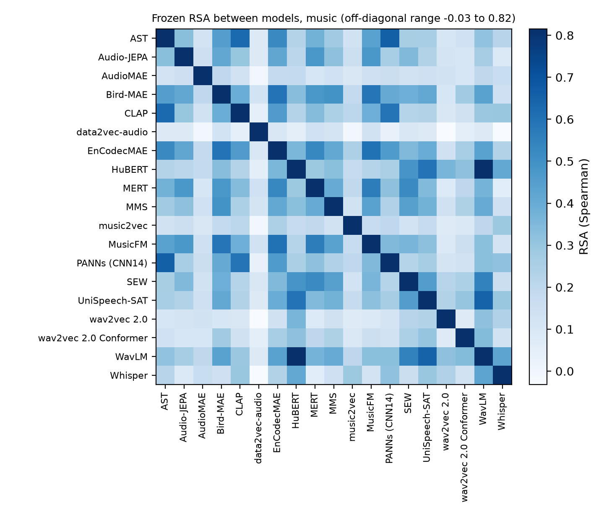
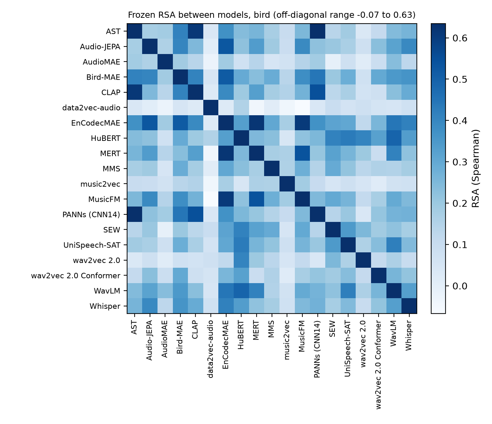
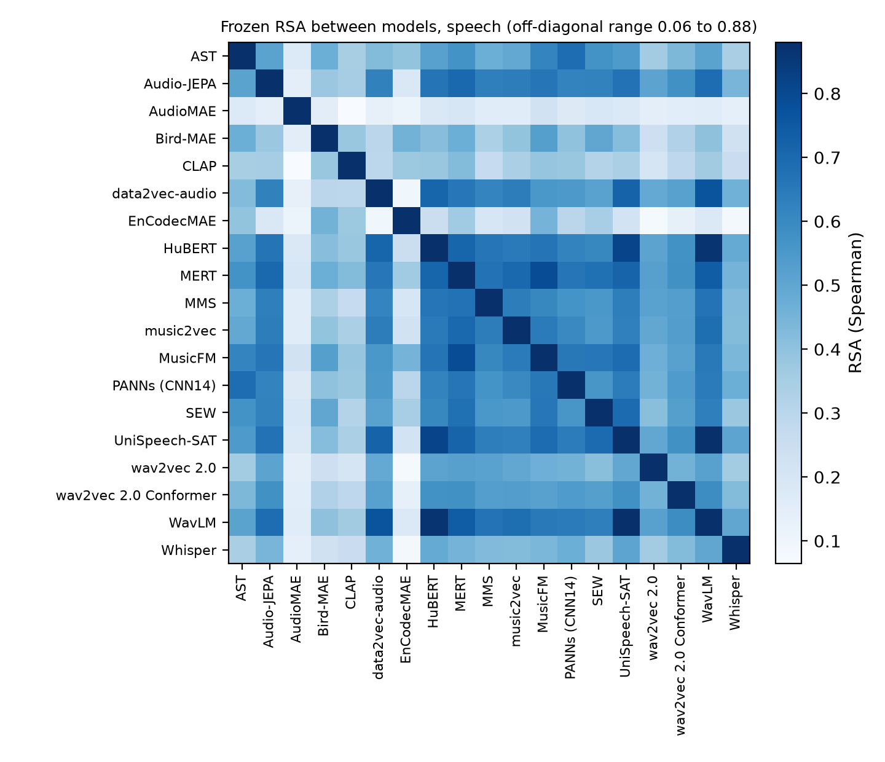
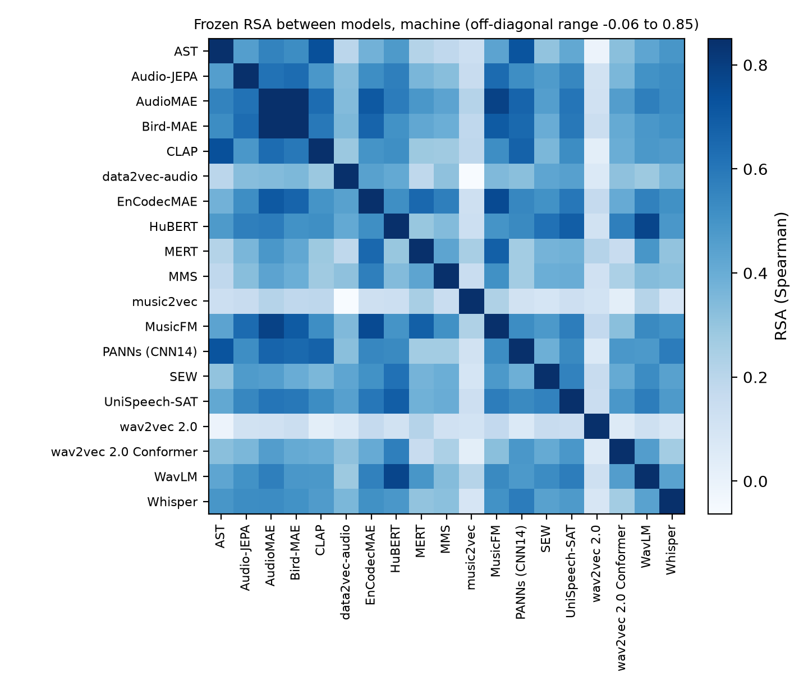

# ECHO: appendix

This appendix accompanies the paper. Every table below is generated by `scripts/paper/make_appendix.py` from the aggregate results in `results/`; the analysis code is in `scripts/paper/` and the experimental specification (datasets, splits, hyper-parameters, metrics, statistical tests) is in [`REPRODUCIBILITY.md`](REPRODUCIBILITY.md). Vessel results are aggregate statistics only; no vessel audio, labels or per-model vessel values are released.

## Contents

A. Model roster and checkpoints  
B. Frozen and adapted accuracy (converged probe)  
C. Frozen usability probes and geometry (Finding 2)  
D. Cross-domain stability and taxonomy tests (Finding 1)  
E. Adaptation gain analyses (Finding 3)  
F. How adaptation reshapes geometry (Finding 3)  
G. Frozen RSA matrices  
H. Robustness checks

## A. Model roster and checkpoints

Pretrained checkpoints used for every model (Hugging Face identifiers unless stated). No adapted weights are distributed: the adaptation pipeline stores only clip × clip RDM and Gram matrices (§4 of REPRODUCIBILITY.md).

| model                 | training paradigm                     |   params (M) | adaptation   | checkpoint                                                                       |
|:----------------------|:--------------------------------------|-------------:|:-------------|:---------------------------------------------------------------------------------|
| AST                   | Supervised/discriminative             |         86.2 | LoRA, ALLoRA | MIT/ast-finetuned-audioset-10-10-0.4593                                          |
| Audio-JEPA            | Joint-embedding and self-distillation |         85.4 | top-K        | ltuncay/Audio-JEPA, JEPA.ckpt                                                    |
| AudioMAE              | Masked modeling and reconstruction    |        111.7 | top-K        | facebookresearch/AudioMAE, pretrained.pth (ViT-B/16, README-linked Google Drive) |
| Bird-MAE              | Masked modeling and reconstruction    |         85.5 | LoRA, ALLoRA | DBD-research-group/Bird-MAE-Base                                                 |
| CLAP                  | Cross-modal contrastive               |        193.9 | LoRA, ALLoRA | laion/larger_clap_general                                                        |
| data2vec-audio        | Joint-embedding and self-distillation |         93.2 | LoRA, ALLoRA | facebook/data2vec-audio-base                                                     |
| EnCodecMAE            | Masked modeling and reconstruction    |        100.6 | frozen only  | habla-liaa/encodecmae, model ec-ec-large_st                                      |
| HuBERT                | Masked modeling and reconstruction    |        315.4 | LoRA, ALLoRA | facebook/hubert-large-ll60k                                                      |
| MERT                  | Masked modeling and reconstruction    |        315.4 | LoRA, ALLoRA | m-a-p/MERT-v1-330M                                                               |
| MMS                   | Masked modeling and reconstruction    |        315.4 | LoRA, ALLoRA | facebook/mms-300m                                                                |
| music2vec             | Joint-embedding and self-distillation |         93.2 | LoRA, ALLoRA | m-a-p/music2vec-v1                                                               |
| MusicFM               | Masked modeling and reconstruction    |        328.9 | top-K        | minzwon/MusicFM, pretrained_msd.pt                                               |
| PANNs (CNN14)         | Supervised/discriminative             |         81.8 | top-K        | Zenodo 3987831, Cnn14_mAP=0.431.pth                                              |
| SEW                   | Masked modeling and reconstruction    |         40.7 | LoRA, ALLoRA | asapp/sew-tiny-100k                                                              |
| UniSpeech-SAT         | Masked modeling and reconstruction    |         94.4 | LoRA, ALLoRA | microsoft/unispeech-sat-base                                                     |
| wav2vec 2.0           | Masked modeling and reconstruction    |        315.4 | LoRA, ALLoRA | facebook/wav2vec2-large-lv60                                                     |
| wav2vec 2.0 Conformer | Masked modeling and reconstruction    |        618.6 | LoRA, ALLoRA | facebook/wav2vec2-conformer-rel-pos-large                                        |
| WavLM                 | Masked modeling and reconstruction    |         94.4 | LoRA, ALLoRA | microsoft/wavlm-base-plus                                                        |
| Whisper               | Supervised/discriminative             |         20.6 | LoRA, ALLoRA | openai/whisper-base                                                              |

## B. Frozen and adapted accuracy (converged probe)

Test accuracy of the converged linear probe on Gram-recovered features of the frozen and the adapted encoder, mean ± SD over seeds. Primary condition: LoRA for the 14 LoRA-eligible models, top-K for the other 4. Gain = adapted − frozen (primary condition). Speech LoRA misses some seeds.

| domain   | model                 |   seeds | frozen        | adapted (primary)     |   gain (primary) | adapted (ALLoRA)   |
|:---------|:----------------------|--------:|:--------------|:----------------------|-----------------:|:-------------------|
| music    | AST                   |       5 | 0.526 ± 0.000 | 0.535 ± 0.012 (LoRA)  |            0.009 | 0.534 ± 0.010      |
| music    | Audio-JEPA            |       5 | 0.456 ± 0.000 | 0.432 ± 0.009 (top-K) |           -0.024 |                    |
| music    | AudioMAE              |       5 | 0.439 ± 0.000 | 0.423 ± 0.013 (top-K) |           -0.016 |                    |
| music    | Bird-MAE              |       5 | 0.428 ± 0.000 | 0.449 ± 0.012 (LoRA)  |            0.021 | 0.447 ± 0.007      |
| music    | CLAP                  |       5 | 0.556 ± 0.000 | 0.553 ± 0.008 (LoRA)  |           -0.003 | 0.555 ± 0.006      |
| music    | data2vec-audio        |       5 | 0.338 ± 0.000 | 0.385 ± 0.029 (LoRA)  |            0.048 | 0.389 ± 0.018      |
| music    | HuBERT                |       5 | 0.393 ± 0.000 | 0.392 ± 0.013 (LoRA)  |           -0.000 | 0.390 ± 0.019      |
| music    | MERT                  |       5 | 0.439 ± 0.000 | 0.473 ± 0.014 (LoRA)  |            0.034 | 0.480 ± 0.023      |
| music    | MMS                   |       5 | 0.436 ± 0.000 | 0.418 ± 0.020 (LoRA)  |           -0.018 | 0.428 ± 0.014      |
| music    | music2vec             |       5 | 0.459 ± 0.000 | 0.517 ± 0.009 (LoRA)  |            0.058 | 0.530 ± 0.007      |
| music    | MusicFM               |       5 | 0.507 ± 0.000 | 0.458 ± 0.005 (top-K) |           -0.050 |                    |
| music    | PANNs (CNN14)         |       5 | 0.500 ± 0.000 | 0.512 ± 0.015 (top-K) |            0.012 |                    |
| music    | SEW                   |       5 | 0.375 ± 0.000 | 0.403 ± 0.014 (LoRA)  |            0.028 | 0.387 ± 0.007      |
| music    | UniSpeech-SAT         |       5 | 0.370 ± 0.000 | 0.414 ± 0.015 (LoRA)  |            0.044 | 0.412 ± 0.016      |
| music    | wav2vec 2.0           |       5 | 0.395 ± 0.000 | 0.401 ± 0.019 (LoRA)  |            0.006 | 0.423 ± 0.017      |
| music    | wav2vec 2.0 Conformer |       5 | 0.384 ± 0.000 | 0.371 ± 0.014 (LoRA)  |           -0.013 | 0.388 ± 0.017      |
| music    | WavLM                 |       5 | 0.390 ± 0.000 | 0.406 ± 0.011 (LoRA)  |            0.016 | 0.404 ± 0.013      |
| music    | Whisper               |       5 | 0.466 ± 0.000 | 0.476 ± 0.014 (LoRA)  |            0.009 | 0.466 ± 0.011      |
| city     | AST                   |       5 | 0.805 ± 0.000 | 0.842 ± 0.010 (LoRA)  |            0.037 | 0.848 ± 0.009      |
| city     | Audio-JEPA            |       5 | 0.604 ± 0.000 | 0.648 ± 0.012 (top-K) |            0.045 |                    |
| city     | AudioMAE              |       5 | 0.695 ± 0.000 | 0.804 ± 0.012 (top-K) |            0.109 |                    |
| city     | Bird-MAE              |       5 | 0.762 ± 0.000 | 0.791 ± 0.015 (LoRA)  |            0.029 | 0.800 ± 0.017      |
| city     | CLAP                  |       5 | 0.836 ± 0.000 | 0.833 ± 0.006 (LoRA)  |           -0.003 | 0.824 ± 0.012      |
| city     | data2vec-audio        |       5 | 0.481 ± 0.000 | 0.604 ± 0.026 (LoRA)  |            0.123 | 0.557 ± 0.022      |
| city     | HuBERT                |       5 | 0.620 ± 0.000 | 0.667 ± 0.020 (LoRA)  |            0.048 | 0.659 ± 0.017      |
| city     | MERT                  |       5 | 0.588 ± 0.000 | 0.742 ± 0.014 (LoRA)  |            0.155 | 0.721 ± 0.024      |
| city     | MMS                   |       5 | 0.621 ± 0.000 | 0.674 ± 0.009 (LoRA)  |            0.053 | 0.667 ± 0.022      |
| city     | music2vec             |       5 | 0.509 ± 0.000 | 0.663 ± 0.016 (LoRA)  |            0.154 | 0.662 ± 0.009      |
| city     | MusicFM               |       5 | 0.676 ± 0.000 | 0.653 ± 0.005 (top-K) |           -0.023 |                    |
| city     | PANNs (CNN14)         |       5 | 0.764 ± 0.000 | 0.808 ± 0.007 (top-K) |            0.044 |                    |
| city     | SEW                   |       5 | 0.596 ± 0.000 | 0.675 ± 0.013 (LoRA)  |            0.079 | 0.673 ± 0.032      |
| city     | UniSpeech-SAT         |       5 | 0.630 ± 0.000 | 0.682 ± 0.021 (LoRA)  |            0.052 | 0.697 ± 0.037      |
| city     | wav2vec 2.0           |       5 | 0.644 ± 0.000 | 0.605 ± 0.021 (LoRA)  |           -0.039 | 0.622 ± 0.018      |
| city     | wav2vec 2.0 Conformer |       5 | 0.615 ± 0.000 | 0.647 ± 0.017 (LoRA)  |            0.032 | 0.645 ± 0.012      |
| city     | WavLM                 |       5 | 0.643 ± 0.000 | 0.654 ± 0.019 (LoRA)  |            0.011 | 0.632 ± 0.028      |
| city     | Whisper               |       5 | 0.731 ± 0.000 | 0.749 ± 0.032 (LoRA)  |            0.018 | 0.716 ± 0.012      |
| bird     | AST                   |       5 | 0.322 ± 0.000 | 0.442 ± 0.014 (LoRA)  |            0.120 | 0.445 ± 0.013      |
| bird     | Audio-JEPA            |       5 | 0.181 ± 0.000 | 0.103 ± 0.018 (top-K) |           -0.077 |                    |
| bird     | AudioMAE              |       5 | 0.232 ± 0.000 | 0.435 ± 0.015 (top-K) |            0.203 |                    |
| bird     | Bird-MAE              |       5 | 0.298 ± 0.000 | 0.390 ± 0.033 (LoRA)  |            0.092 | 0.360 ± 0.021      |
| bird     | CLAP                  |       5 | 0.339 ± 0.000 | 0.446 ± 0.012 (LoRA)  |            0.107 | 0.419 ± 0.021      |
| bird     | data2vec-audio        |       5 | 0.119 ± 0.000 | 0.127 ± 0.006 (LoRA)  |            0.008 | 0.155 ± 0.009      |
| bird     | HuBERT                |       5 | 0.253 ± 0.000 | 0.316 ± 0.005 (LoRA)  |            0.064 | 0.321 ± 0.013      |
| bird     | MERT                  |       5 | 0.191 ± 0.000 | 0.312 ± 0.018 (LoRA)  |            0.121 | 0.299 ± 0.018      |
| bird     | MMS                   |       5 | 0.248 ± 0.000 | 0.322 ± 0.011 (LoRA)  |            0.074 | 0.327 ± 0.029      |
| bird     | music2vec             |       5 | 0.142 ± 0.000 | 0.189 ± 0.014 (LoRA)  |            0.047 | 0.174 ± 0.015      |
| bird     | MusicFM               |       5 | 0.207 ± 0.000 | 0.194 ± 0.003 (top-K) |           -0.013 |                    |
| bird     | PANNs (CNN14)         |       5 | 0.264 ± 0.000 | 0.403 ± 0.032 (top-K) |            0.139 |                    |
| bird     | SEW                   |       5 | 0.202 ± 0.000 | 0.247 ± 0.012 (LoRA)  |            0.044 | 0.244 ± 0.014      |
| bird     | UniSpeech-SAT         |       5 | 0.219 ± 0.000 | 0.286 ± 0.023 (LoRA)  |            0.067 | 0.295 ± 0.015      |
| bird     | wav2vec 2.0           |       5 | 0.232 ± 0.000 | 0.228 ± 0.015 (LoRA)  |           -0.004 | 0.234 ± 0.014      |
| bird     | wav2vec 2.0 Conformer |       5 | 0.225 ± 0.000 | 0.261 ± 0.009 (LoRA)  |            0.035 | 0.260 ± 0.024      |
| bird     | WavLM                 |       5 | 0.284 ± 0.000 | 0.279 ± 0.018 (LoRA)  |           -0.004 | 0.244 ± 0.026      |
| bird     | Whisper               |       5 | 0.288 ± 0.000 | 0.310 ± 0.026 (LoRA)  |            0.023 | 0.293 ± 0.023      |
| speech   | AST                   |       4 | 0.961 ± 0.000 | 0.998 ± 0.001 (LoRA)  |            0.037 | 0.997 ± 0.001      |
| speech   | Audio-JEPA            |       5 | 0.848 ± 0.000 | 0.867 ± 0.003 (top-K) |            0.019 |                    |
| speech   | AudioMAE              |       5 | 0.757 ± 0.000 | 0.987 ± 0.003 (top-K) |            0.229 |                    |
| speech   | Bird-MAE              |       4 | 0.992 ± 0.000 | 0.988 ± 0.003 (LoRA)  |           -0.004 | 0.988 ± 0.002      |
| speech   | CLAP                  |       4 | 0.995 ± 0.000 | 0.998 ± 0.001 (LoRA)  |            0.003 | 0.998 ± 0.001      |
| speech   | data2vec-audio        |       4 | 0.701 ± 0.000 | 0.972 ± 0.002 (LoRA)  |            0.271 | 0.967 ± 0.007      |
| speech   | HuBERT                |       4 | 0.955 ± 0.000 | 0.999 ± 0.000 (LoRA)  |            0.044 | 0.999 ± 0.000      |
| speech   | MERT                  |       4 | 0.936 ± 0.000 | 0.998 ± 0.001 (LoRA)  |            0.062 | 0.997 ± 0.001      |
| speech   | MMS                   |       2 | 0.985 ± 0.000 | 1.000 ± 0.000 (LoRA)  |            0.015 | 0.999 ± 0.000      |
| speech   | music2vec             |       3 | 0.732 ± 0.000 | 0.845 ± 0.027 (LoRA)  |            0.114 | 0.841 ± 0.013      |
| speech   | MusicFM               |       5 | 0.981 ± 0.000 | 0.972 ± 0.001 (top-K) |           -0.008 |                    |
| speech   | PANNs (CNN14)         |       4 | 0.779 ± 0.000 | 0.980 ± 0.003 (top-K) |            0.201 |                    |
| speech   | SEW                   |       3 | 0.968 ± 0.000 | 0.992 ± 0.001 (LoRA)  |            0.024 | 0.989 ± 0.002      |
| speech   | UniSpeech-SAT         |       3 | 0.987 ± 0.000 | 0.999 ± 0.000 (LoRA)  |            0.012 | 0.998 ± 0.001      |
| speech   | wav2vec 2.0           |       4 | 0.970 ± 0.000 | 0.908 ± 0.076 (LoRA)  |           -0.062 | 0.878 ± 0.048      |
| speech   | wav2vec 2.0 Conformer |       3 | 0.987 ± 0.000 | 0.991 ± 0.002 (LoRA)  |            0.005 | 0.992 ± 0.003      |
| speech   | WavLM                 |       4 | 0.968 ± 0.000 | 0.987 ± 0.002 (LoRA)  |            0.019 | 0.983 ± 0.001      |
| speech   | Whisper               |       3 | 0.979 ± 0.000 | 0.966 ± 0.005 (LoRA)  |           -0.013 | 0.972 ± 0.006      |
| machine  | AST                   |       5 | 0.513 ± 0.000 | 0.498 ± 0.021 (LoRA)  |           -0.015 | 0.512 ± 0.031      |
| machine  | Audio-JEPA            |       5 | 0.483 ± 0.000 | 0.433 ± 0.024 (top-K) |           -0.050 |                    |
| machine  | AudioMAE              |       5 | 0.475 ± 0.000 | 0.476 ± 0.009 (top-K) |            0.001 |                    |
| machine  | Bird-MAE              |       5 | 0.465 ± 0.000 | 0.510 ± 0.039 (LoRA)  |            0.045 | 0.466 ± 0.028      |
| machine  | CLAP                  |       5 | 0.510 ± 0.000 | 0.524 ± 0.033 (LoRA)  |            0.014 | 0.523 ± 0.035      |
| machine  | data2vec-audio        |       5 | 0.547 ± 0.000 | 0.488 ± 0.018 (LoRA)  |           -0.058 | 0.494 ± 0.038      |
| machine  | HuBERT                |       5 | 0.453 ± 0.000 | 0.495 ± 0.029 (LoRA)  |            0.041 | 0.477 ± 0.027      |
| machine  | MERT                  |       5 | 0.483 ± 0.000 | 0.470 ± 0.022 (LoRA)  |           -0.013 | 0.498 ± 0.026      |
| machine  | MMS                   |       5 | 0.483 ± 0.000 | 0.494 ± 0.040 (LoRA)  |            0.011 | 0.519 ± 0.023      |
| machine  | music2vec             |       5 | 0.485 ± 0.000 | 0.484 ± 0.039 (LoRA)  |           -0.001 | 0.497 ± 0.044      |
| machine  | MusicFM               |       5 | 0.515 ± 0.000 | 0.502 ± 0.006 (top-K) |           -0.013 |                    |
| machine  | PANNs (CNN14)         |       5 | 0.503 ± 0.000 | 0.487 ± 0.020 (top-K) |           -0.016 |                    |
| machine  | SEW                   |       5 | 0.532 ± 0.000 | 0.540 ± 0.020 (LoRA)  |            0.009 | 0.512 ± 0.031      |
| machine  | UniSpeech-SAT         |       5 | 0.593 ± 0.000 | 0.542 ± 0.032 (LoRA)  |           -0.051 | 0.526 ± 0.019      |
| machine  | wav2vec 2.0           |       5 | 0.543 ± 0.000 | 0.484 ± 0.058 (LoRA)  |           -0.059 | 0.492 ± 0.027      |
| machine  | wav2vec 2.0 Conformer |       5 | 0.468 ± 0.000 | 0.517 ± 0.024 (LoRA)  |            0.049 | 0.508 ± 0.017      |
| machine  | WavLM                 |       5 | 0.500 ± 0.000 | 0.520 ± 0.051 (LoRA)  |            0.020 | 0.458 ± 0.024      |
| machine  | Whisper               |       5 | 0.468 ± 0.000 | 0.483 ± 0.012 (LoRA)  |            0.015 | 0.471 ± 0.032      |

## C. Frozen usability probes and geometry (Finding 2)

Linear: logistic regression (C = 1) on standardized frozen embeddings; linear (converged): the same model run to convergence, used for the kNN − linear gap; kNN: k = 10. Geometry columns are computed on each domain's full pool.

| domain   | model                 |   n_test |   linear |   linear (converged) |   knn |   uniformity |   alignment |   TwoNN |
|:---------|:----------------------|---------:|---------:|---------------------:|------:|-------------:|------------:|--------:|
| bird     | AST                   |     1499 |    0.442 |                0.468 | 0.354 |       -1.843 |       0.843 |  10.928 |
| bird     | Audio-JEPA            |     1499 |    0.196 |                0.178 | 0.086 |       -0.111 |       0.055 |   7.907 |
| bird     | AudioMAE              |     1499 |    0.282 |                0.282 | 0.161 |       -0.098 |       0.048 |  10.758 |
| bird     | Bird-MAE              |     1499 |    0.454 |                0.442 | 0.307 |       -0.108 |       0.046 |   9.298 |
| bird     | CLAP                  |     1499 |    0.322 |                0.333 | 0.226 |       -1.586 |       0.732 |   9.781 |
| bird     | data2vec-audio        |     1499 |    0.106 |                0.113 | 0.090 |       -0.520 |       0.468 |  11.406 |
| bird     | EnCodecMAE            |     1499 |    0.286 |                0.308 | 0.192 |       -1.036 |       0.487 |   7.404 |
| bird     | HuBERT                |     1499 |    0.337 |                0.360 | 0.241 |       -0.745 |       0.378 |  12.457 |
| bird     | MERT                  |     1499 |    0.292 |                0.298 | 0.201 |       -0.704 |       0.351 |   7.517 |
| bird     | MMS                   |     1499 |    0.350 |                0.352 | 0.184 |       -0.064 |       0.028 |   8.531 |
| bird     | music2vec             |     1499 |    0.151 |                0.171 | 0.109 |       -0.596 |       0.296 |  20.033 |
| bird     | MusicFM               |     1499 |    0.295 |                0.293 | 0.150 |       -1.330 |       0.641 |  11.499 |
| bird     | PANNs (CNN14)         |     1499 |    0.317 |                0.334 | 0.243 |       -0.927 |       0.419 |   9.550 |
| bird     | SEW                   |     1499 |    0.254 |                0.262 | 0.181 |       -0.282 |       0.129 |   6.746 |
| bird     | UniSpeech-SAT         |     1499 |    0.243 |                0.254 | 0.188 |       -1.692 |       0.852 |  12.159 |
| bird     | wav2vec 2.0           |     1499 |    0.243 |                0.259 | 0.152 |       -0.014 |       0.007 |  10.654 |
| bird     | wav2vec 2.0 Conformer |     1499 |    0.256 |                0.269 | 0.179 |       -0.761 |       0.384 |  15.921 |
| bird     | WavLM                 |     1499 |    0.318 |                0.329 | 0.209 |       -1.047 |       0.531 |   9.280 |
| bird     | Whisper               |     1499 |    0.362 |                0.368 | 0.195 |       -0.028 |       0.013 |  10.311 |
| city     | AST                   |      873 |    0.835 |                0.855 | 0.844 |       -2.172 |       0.836 |   6.183 |
| city     | Audio-JEPA            |      873 |    0.656 |                0.661 | 0.551 |       -0.196 |       0.079 |   7.736 |
| city     | AudioMAE              |      873 |    0.733 |                0.731 | 0.612 |       -0.170 |       0.079 |  10.709 |
| city     | Bird-MAE              |      873 |    0.785 |                0.809 | 0.773 |       -0.173 |       0.065 |   7.803 |
| city     | CLAP                  |      873 |    0.816 |                0.811 | 0.802 |       -2.491 |       0.916 |   7.191 |
| city     | data2vec-audio        |      873 |    0.480 |                0.495 | 0.384 |       -0.522 |       0.348 |  10.730 |
| city     | EnCodecMAE            |      873 |    0.698 |                0.688 | 0.641 |       -1.472 |       0.637 |   5.530 |
| city     | HuBERT                |      873 |    0.661 |                0.679 | 0.617 |       -0.823 |       0.400 |  11.869 |
| city     | MERT                  |      873 |    0.683 |                0.687 | 0.593 |       -1.048 |       0.484 |   6.395 |
| city     | MMS                   |      873 |    0.652 |                0.651 | 0.656 |       -0.250 |       0.123 |   7.086 |
| city     | music2vec             |      873 |    0.560 |                0.552 | 0.471 |       -0.972 |       0.529 |  17.076 |
| city     | MusicFM               |      873 |    0.711 |                0.738 | 0.665 |       -1.548 |       0.699 |   8.742 |
| city     | PANNs (CNN14)         |      873 |    0.789 |                0.803 | 0.755 |       -1.485 |       0.541 |   6.032 |
| city     | SEW                   |      873 |    0.623 |                0.625 | 0.526 |       -0.237 |       0.095 |   5.885 |
| city     | UniSpeech-SAT         |      873 |    0.620 |                0.622 | 0.603 |       -1.773 |       0.847 |  10.260 |
| city     | wav2vec 2.0           |      873 |    0.685 |                0.695 | 0.550 |       -0.020 |       0.014 |  10.172 |
| city     | wav2vec 2.0 Conformer |      873 |    0.651 |                0.662 | 0.551 |       -0.955 |       0.489 |  15.968 |
| city     | WavLM                 |      873 |    0.643 |                0.648 | 0.613 |       -1.177 |       0.560 |   8.866 |
| city     | Whisper               |      873 |    0.686 |                0.722 | 0.656 |       -0.037 |       0.014 |   9.612 |
| machine  | AST                   |      480 |    0.927 |                0.935 | 0.921 |       -1.804 |       1.043 |  12.449 |
| machine  | Audio-JEPA            |      480 |    0.854 |                0.856 | 0.781 |       -0.110 |       0.056 |   8.822 |
| machine  | AudioMAE              |      480 |    0.940 |                0.944 | 0.917 |       -0.102 |       0.051 |  11.007 |
| machine  | Bird-MAE              |      480 |    0.908 |                0.917 | 0.850 |       -0.089 |       0.045 |  12.749 |
| machine  | CLAP                  |      480 |    0.894 |                0.896 | 0.885 |       -1.045 |       0.566 |  10.595 |
| machine  | data2vec-audio        |      480 |    0.740 |                0.752 | 0.698 |       -0.397 |       0.309 |   8.182 |
| machine  | EnCodecMAE            |      480 |    0.933 |                0.950 | 0.894 |       -0.700 |       0.380 |   8.491 |
| machine  | HuBERT                |      480 |    0.825 |                0.833 | 0.829 |       -0.554 |       0.314 |  11.069 |
| machine  | MERT                  |      480 |    0.952 |                0.956 | 0.873 |       -0.348 |       0.180 |   8.741 |
| machine  | MMS                   |      480 |    0.927 |                0.929 | 0.858 |       -0.037 |       0.018 |   8.435 |
| machine  | music2vec             |      480 |    0.840 |                0.840 | 0.854 |       -0.662 |       0.352 |  12.065 |
| machine  | MusicFM               |      480 |    0.927 |                0.929 | 0.890 |       -0.702 |       0.368 |  10.133 |
| machine  | PANNs (CNN14)         |      480 |    0.887 |                0.877 | 0.871 |       -0.964 |       0.537 |  10.100 |
| machine  | SEW                   |      480 |    0.848 |                0.854 | 0.810 |       -0.131 |       0.067 |   6.072 |
| machine  | UniSpeech-SAT         |      480 |    0.863 |                0.871 | 0.808 |       -1.263 |       0.718 |   9.890 |
| machine  | wav2vec 2.0           |      480 |    0.863 |                0.867 | 0.754 |       -0.003 |       0.002 |   7.630 |
| machine  | WavLM                 |      480 |    0.881 |                0.883 | 0.825 |       -0.783 |       0.453 |   8.074 |
| machine  | Whisper               |      480 |    0.873 |                0.877 | 0.844 |       -0.025 |       0.012 |  11.350 |
| music    | AST                   |      800 |    0.476 |                0.468 | 0.539 |       -2.491 |       1.163 |  22.262 |
| music    | Audio-JEPA            |      800 |    0.427 |                0.431 | 0.376 |       -0.691 |       0.334 |  14.899 |
| music    | AudioMAE              |      800 |    0.441 |                0.445 | 0.407 |       -0.331 |       0.164 |  24.299 |
| music    | Bird-MAE              |      800 |    0.436 |                0.427 | 0.432 |       -0.142 |       0.064 |  26.523 |
| music    | CLAP                  |      800 |    0.546 |                0.542 | 0.588 |       -2.603 |       1.188 |  16.273 |
| music    | data2vec-audio        |      800 |    0.334 |                0.326 | 0.321 |       -0.777 |       0.574 |  16.532 |
| music    | EnCodecMAE            |      800 |    0.491 |                0.484 | 0.466 |       -1.333 |       0.635 |  18.359 |
| music    | HuBERT                |      800 |    0.417 |                0.414 | 0.338 |       -0.678 |       0.345 |  23.737 |
| music    | MERT                  |      800 |    0.420 |                0.422 | 0.383 |       -0.711 |       0.337 |  22.044 |
| music    | MMS                   |      800 |    0.430 |                0.435 | 0.393 |       -0.032 |       0.015 |  24.077 |
| music    | music2vec             |      800 |    0.438 |                0.432 | 0.451 |       -0.698 |       0.331 |  26.189 |
| music    | MusicFM               |      800 |    0.479 |                0.468 | 0.495 |       -1.426 |       0.699 |  26.470 |
| music    | PANNs (CNN14)         |      800 |    0.446 |                0.448 | 0.497 |       -1.465 |       0.653 |  16.521 |
| music    | SEW                   |      800 |    0.388 |                0.393 | 0.338 |       -0.189 |       0.088 |  16.402 |
| music    | UniSpeech-SAT         |      800 |    0.396 |                0.403 | 0.315 |       -1.329 |       0.680 |  24.813 |
| music    | wav2vec 2.0           |      800 |    0.361 |                0.362 | 0.343 |       -0.007 |       0.003 |  16.238 |
| music    | wav2vec 2.0 Conformer |      800 |    0.385 |                0.383 | 0.321 |       -0.866 |       0.450 |  25.371 |
| music    | WavLM                 |      800 |    0.399 |                0.410 | 0.325 |       -0.983 |       0.489 |  21.419 |
| music    | Whisper               |      800 |    0.445 |                0.435 | 0.439 |       -0.080 |       0.034 |  22.813 |
| speech   | AST                   |     1505 |    0.927 |                0.966 | 0.795 |       -1.183 |       0.376 |  18.304 |
| speech   | Audio-JEPA            |     1505 |    0.760 |                0.823 | 0.353 |       -0.261 |       0.152 |  13.283 |
| speech   | AudioMAE              |     1505 |    0.640 |                0.716 | 0.274 |       -0.306 |       0.133 |  21.930 |
| speech   | Bird-MAE              |     1505 |    0.969 |                0.989 | 0.897 |       -0.065 |       0.019 |  20.288 |
| speech   | CLAP                  |     1505 |    0.981 |                0.992 | 0.968 |       -2.081 |       0.455 |  13.775 |
| speech   | data2vec-audio        |     1505 |    0.708 |                0.783 | 0.443 |       -0.266 |       0.258 |  37.959 |
| speech   | EnCodecMAE            |     1505 |    0.997 |                0.999 | 0.997 |       -1.109 |       0.149 |  17.387 |
| speech   | HuBERT                |     1505 |    0.935 |                0.977 | 0.869 |       -2.010 |       0.782 |  25.853 |
| speech   | MERT                  |     1505 |    0.938 |                0.965 | 0.902 |       -0.353 |       0.144 |  13.839 |
| speech   | MMS                   |     1505 |    0.965 |                0.991 | 0.898 |       -0.040 |       0.018 |  14.009 |
| speech   | music2vec             |     1505 |    0.754 |                0.775 | 0.601 |       -0.551 |       0.349 |  26.776 |
| speech   | MusicFM               |     1505 |    0.952 |                0.970 | 0.873 |       -0.559 |       0.212 |  19.615 |
| speech   | PANNs (CNN14)         |     1505 |    0.728 |                0.774 | 0.494 |       -0.468 |       0.173 |  18.360 |
| speech   | SEW                   |     1505 |    0.938 |                0.963 | 0.858 |       -0.059 |       0.017 |  13.572 |
| speech   | UniSpeech-SAT         |     1505 |    0.963 |                0.976 | 0.885 |       -0.560 |       0.243 |  20.907 |
| speech   | wav2vec 2.0           |     1505 |    0.958 |                0.980 | 0.666 |       -0.018 |       0.009 |  11.050 |
| speech   | wav2vec 2.0 Conformer |     1505 |    0.926 |                0.981 | 0.723 |       -0.356 |       0.150 |  16.057 |
| speech   | WavLM                 |     1505 |    0.924 |                0.962 | 0.811 |       -0.585 |       0.327 |  24.377 |
| speech   | Whisper               |     1505 |    0.897 |                0.955 | 0.456 |       -0.062 |       0.028 |  31.013 |

Summary statistics (`finding2.py`):

| statistic                                              | value                  |
|:-------------------------------------------------------|:-----------------------|
| sign_test_ratio_ast_clap_higher                        | 5/5                    |
| sign_test_ratio_ast_clap_p_two_sided                   | 0.0625                 |
| sign_test_ratio_all_supervised_contrastive_higher      | 4/5                    |
| sign_test_ratio_all_supervised_contrastive_p_two_sided | 0.375                  |
| bird_birdmae_over_audiomae_linear                      | 1.6073706591070163     |
| bird_birdmae_over_audiomae_knn                         | 1.908582089552239      |
| bird_birdmae_minus_audiomae_linear                     | 0.1714                 |
| bird_birdmae_minus_audiomae_knn                        | 0.1461                 |
| music_birdmae_over_audiomae_linear                     | 0.9888939256572984     |
| music_birdmae_over_audiomae_knn                        | 1.0613496932515338     |
| music_birdmae_minus_audiomae_linear                    | -0.00489999999999996   |
| music_birdmae_minus_audiomae_knn                       | 0.025000000000000022   |
| machine_birdmae_over_audiomae_linear                   | 0.9666879523201363     |
| machine_birdmae_over_audiomae_knn                      | 0.927239009490564      |
| machine_birdmae_minus_audiomae_linear                  | -0.031299999999999994  |
| machine_birdmae_minus_audiomae_knn                     | -0.06669999999999998   |
| n_rows                                                 | 94                     |
| rho_uniformity_knn                                     | -0.3580155043613905    |
| p_uniformity_knn                                       | 0.00039584130534752463 |
| rho_uniformity_gap                                     | -0.37486544088429724   |
| p_uniformity_gap                                       | 0.00019723588711395023 |
| partial_rho_uniformity_knn_given_logparams             | -0.34099627930498866   |
| partial_p                                              | 0.0007703186076812216  |
| vif_uniformity_logparams                               | 1.0170405222408834     |

kNN/linear accuracy ratio by domain:

| domain   | best_discriminative_model   |   its_rank_linear |   its_rank_knn |   ratio_ast_clap |   ratio_all_supervised_contrastive |   ratio_reconstruction |
|:---------|:----------------------------|------------------:|---------------:|-----------------:|-----------------------------------:|-----------------------:|
| bird     | ast                         |             2.000 |          1.000 |            0.752 |                              0.702 |                  0.652 |
| music    | clap                        |             1.000 |          1.000 |            1.103 |                              1.077 |                  0.899 |
| speech   | clap                        |             2.000 |          2.000 |            0.922 |                              0.758 |                  0.857 |
| machine  | ast                         |             5.000 |          1.000 |            0.992 |                              0.983 |                  0.944 |
| city     | ast                         |             1.000 |          1.000 |            0.997 |                              0.977 |                  0.909 |

## D. Cross-domain stability and taxonomy tests (Finding 1)

Spearman ρ between two domains' 19 × 19 frozen RSA matrices (171 model pairs), one-sided model-identity permutation test (10,000 permutations), BH over the 15 pairs. LOO: range of ρ when each model is removed.

| domain A   | domain B   |     rho |   p_perm |   q_bh |   loo_min |   loo_max | model whose removal gives the minimum   |
|:-----------|:-----------|--------:|---------:|-------:|----------:|----------:|:----------------------------------------|
| music      | bird       |  0.8148 |   0.0001 | 0.0004 |    0.7770 |    0.8779 | data2vec_audio                          |
| city       | bird       |  0.6141 |   0.0001 | 0.0004 |    0.5255 |    0.6737 | data2vec_audio                          |
| bird       | machine    |  0.6379 |   0.0001 | 0.0004 |    0.5804 |    0.7602 | music2vec                               |
| bird       | vessel     |  0.6443 |   0.0001 | 0.0004 |    0.5362 |    0.7227 | data2vec_audio                          |
| music      | city       |  0.6271 |   0.0002 | 0.0005 |    0.5542 |    0.6831 | data2vec_audio                          |
| machine    | vessel     |  0.6585 |   0.0002 | 0.0005 |    0.5663 |    0.7213 | music2vec                               |
| music      | machine    |  0.5166 |   0.0015 | 0.0032 |    0.4631 |    0.6436 | wav2vec2                                |
| music      | vessel     |  0.4751 |   0.0036 | 0.0067 |    0.3248 |    0.5678 | data2vec_audio                          |
| city       | vessel     |  0.3857 |   0.0131 | 0.0199 |    0.2584 |    0.4572 | data2vec_audio                          |
| city       | speech     |  0.4161 |   0.0133 | 0.0199 |    0.3671 |    0.4923 | hubert                                  |
| city       | machine    |  0.3993 |   0.0146 | 0.0199 |    0.2541 |    0.4970 | wav2vec2                                |
| music      | speech     |  0.2181 |   0.1260 | 0.1575 |    0.0879 |    0.3170 | audiomae                                |
| bird       | speech     |  0.1056 |   0.2678 | 0.3090 |   -0.0439 |    0.2199 | audiomae                                |
| speech     | machine    | -0.0997 |   0.6794 | 0.7032 |   -0.1858 |    0.0265 | wav2vec2                                |
| speech     | vessel     | -0.1061 |   0.7032 | 0.7032 |   -0.1616 |   -0.0502 | musicfm                                 |

Leave-one-model-out with BH within each roster (5,000 permutations): no removal makes a speech pair significant; removing AST or wav2vec 2.0 drops city–machine below significance and removing data2vec-audio drops city–vessel; every other removal leaves all 11 pairs significant (`results/finding1/cross_domain_leave_one_out.txt`).

Taxonomy alignment: Mantel r between each domain's RSA matrix and a same-group indicator, one-sided permutation p (200,000 permutations), 95% bootstrap CI over models. None of the 12 tests survives BH at q = 0.05.

| domain   | taxonomy        |   n_models |   mantel_r |   p_perm |   ci_lo |   ci_hi | bh_survives   |
|:---------|:----------------|-----------:|-----------:|---------:|--------:|--------:|:--------------|
| City     | domain+paradigm |         19 |     0.2728 |   0.0295 | -0.0012 |  0.5875 | False         |
| City     | breadth         |         19 |     0.0453 |   0.3076 | -0.1911 |  0.3789 | False         |
| Speech   | domain+paradigm |         19 |     0.3108 |   0.0216 |  0.0843 |  0.5434 | False         |
| Speech   | breadth         |         19 |     0.0981 |   0.1732 | -0.2117 |  0.4443 | False         |
| Music    | domain+paradigm |         19 |     0.2853 |   0.0207 | -0.0264 |  0.6137 | False         |
| Music    | breadth         |         19 |     0.2002 |   0.0256 | -0.0847 |  0.5403 | False         |
| Bird     | domain+paradigm |         19 |     0.1707 |   0.1075 | -0.0841 |  0.4915 | False         |
| Bird     | breadth         |         19 |     0.2360 |   0.0108 | -0.0201 |  0.5335 | False         |
| Vessel   | domain+paradigm |         19 |     0.1680 |   0.1419 | -0.1040 |  0.4626 | False         |
| Vessel   | breadth         |         19 |     0.2160 |   0.0252 | -0.0895 |  0.5357 | False         |
| Machine  | domain+paradigm |         19 |    -0.0046 |   0.4964 | -0.2564 |  0.3600 | False         |
| Machine  | breadth         |         19 |     0.2021 |   0.0322 | -0.0891 |  0.5131 | False         |

Group definitions (`audio_comp/pipelines/breadth_hypothesis_check.py`; models not listed form singleton groups):

| grouping              | group                          | models                                                                                |
|:----------------------|:-------------------------------|:--------------------------------------------------------------------------------------|
| domain + paradigm     | masked_modeling_speech         | HuBERT, wav2vec 2.0, WavLM, UniSpeech-SAT, SEW, wav2vec 2.0 Conformer, MMS            |
| domain + paradigm     | masked_modeling_music          | MERT, MusicFM                                                                         |
| domain + paradigm     | data2vec_music                 | music2vec                                                                             |
| domain + paradigm     | data2vec_speech                | data2vec-audio                                                                        |
| domain + paradigm     | contrastive_general            | CLAP                                                                                  |
| domain + paradigm     | jepa_general                   | Audio-JEPA                                                                            |
| domain + paradigm     | reconstruction_bioacoustic     | Bird-MAE                                                                              |
| domain + paradigm     | supervised_cnn_general         | PANNs (CNN14)                                                                         |
| domain + paradigm     | supervised_transformer_general | AST                                                                                   |
| domain + paradigm     | reconstruction_general         | AudioMAE                                                                              |
| domain + paradigm     | supervised_asr_speech          | Whisper                                                                               |
| domain + paradigm     | masked_codec_general           | EnCodecMAE                                                                            |
| training-data breadth | narrow_speech                  | HuBERT, wav2vec 2.0, WavLM, data2vec-audio, UniSpeech-SAT, SEW, wav2vec 2.0 Conformer |
| training-data breadth | narrow_music                   | MERT, MusicFM                                                                         |
| training-data breadth | narrow_bioacoustic             | Bird-MAE                                                                              |
| training-data breadth | broad_mixed                    | Audio-JEPA, CLAP, PANNs (CNN14), AST, AudioMAE, EnCodecMAE                            |
| training-data breadth | broad_speech                   | MMS, Whisper                                                                          |
| training-data breadth | self_distillation_narrow_music | music2vec                                                                             |

## E. Adaptation gain analyses (Finding 3)

Regression gain ~ difficulty + uniformity + domain match (model-clustered SE; R² CI and within-domain ρ CI from 2,000 model bootstraps):

| variant                                |   n_rows |   n_models |     R2 |   b_difficulty |   b_uniformity |   b_domain_match |   se_difficulty |   se_uniformity |   se_domain_match |   p_difficulty |   p_uniformity |   p_domain_match |   R2_ci_lo |   R2_ci_hi |   within_rho |   within_rho_ci_lo |   within_rho_ci_hi |   n_pairs |
|:---------------------------------------|---------:|-----------:|-------:|---------------:|---------------:|-----------------:|----------------:|----------------:|------------------:|---------------:|---------------:|-----------------:|-----------:|-----------:|-------------:|-------------------:|-------------------:|----------:|
| all public domains                     |      428 |         18 | 0.0759 |         0.0629 |         0.0034 |          -0.0156 |          0.0270 |          0.0107 |            0.0237 |         0.0322 |         0.7511 |           0.5190 |     0.0212 |     0.2171 |      -0.0112 |            -0.3164 |             0.2542 |   90.0000 |
| without machine                        |      338 |         18 | 0.0178 |         0.0309 |         0.0057 |          -0.0142 |          0.0293 |          0.0121 |            0.0230 |         0.3065 |         0.6444 |           0.5444 |   nan      |   nan      |     nan      |           nan      |           nan      |  nan      |
| speech complete seeds only             |      395 |         18 | 0.0716 |         0.0619 |         0.0023 |          -0.0114 |          0.0250 |          0.0098 |            0.0207 |         0.0243 |         0.8204 |           0.5889 |   nan      |   nan      |     nan      |           nan      |           nan      |  nan      |
| (model, domain) pairs with all 5 seeds |      375 |         18 | 0.0870 |         0.0737 |         0.0036 |           0.0031 |          0.0311 |          0.0108 |            0.0264 |         0.0298 |         0.7449 |           0.9081 |   nan      |   nan      |     nan      |           nan      |           nan      |  nan      |

Predictor search (leave-one-model-out CV R², permutation p over the full search, 2,000 permutations):

| target      | pool                      |   n_pairs |   uniformity_alone_cv_r2 | best                                  |   best_cv_r2 |   perm_p |   p_bonferroni_6 | second                        |   second_cv_r2 | third                                      |   third_cv_r2 |
|:------------|:--------------------------|----------:|-------------------------:|:--------------------------------------|-------------:|---------:|-----------------:|:------------------------------|---------------:|:-------------------------------------------|--------------:|
| gain        | frozen, label-free        |        89 |                  -0.0805 | twonn                                 |      -0.0180 |   0.4193 |           1.0000 | twonn + domain_match          |        -0.0315 | uniformity + twonn                         |       -0.0441 |
| gain        | frozen, incl. label-using |        89 |                  -0.0805 | discriminative + linear + frozen_acc  |       0.2596 |   0.0030 |           0.0180 | discriminative + frozen_acc   |         0.2555 | domain_match + discriminative + frozen_acc |        0.2421 |
| gain        | incl. post-hoc d_uni      |        89 |                  -0.0805 | discriminative + linear + frozen_acc  |       0.2596 |   0.0055 |           0.0330 | discriminative + frozen_acc   |         0.2555 | domain_match + discriminative + frozen_acc |        0.2421 |
| adapted_acc | frozen, label-free        |        89 |                   0.0170 | twonn + domain_match + discriminative |       0.2012 |   0.0120 |           0.0720 | domain_match + discriminative |         0.2011 | uniformity + domain_match + discriminative |        0.1998 |
| adapted_acc | frozen, incl. label-using |        89 |                   0.0170 | discriminative + linear + frozen_acc  |       0.4285 |   0.0005 |           0.0030 | discriminative + frozen_acc   |         0.4253 | domain_match + discriminative + frozen_acc |        0.4149 |
| adapted_acc | incl. post-hoc d_uni      |        89 |                   0.0170 | discriminative + linear + frozen_acc  |       0.4285 |   0.0005 |           0.0030 | discriminative + frozen_acc   |         0.4253 | domain_match + discriminative + frozen_acc |        0.4149 |

Transferability estimators vs gain (within-domain Spearman, permutation p, model-bootstrap CI):

| estimator        |   n_pairs |   within_domain_rho |   perm_p |   ci_lo |   ci_hi |
|:-----------------|----------:|--------------------:|---------:|--------:|--------:|
| logme            |        90 |             -0.1339 |   0.2789 | -0.3438 |  0.1012 |
| knn_ref_accuracy |        90 |             -0.0775 |   0.6127 | -0.4104 |  0.3037 |
| uniformity       |        90 |             -0.0112 |   0.9426 | -0.3120 |  0.2739 |

## F. How adaptation reshapes geometry (Finding 3)

ΔRSA (mean over models of the change in mean RSA to the other models; WavLM excluded) and preserved ordering (Spearman between frozen and adapted mean RSA, permutation p, BH over 10 cells):

| domain       | method   |   seeds |   mean_delta_rsa |   sd_over_seeds |   n_models_order |   rho_order |   p_order |   q_order |
|:-------------|:---------|--------:|-----------------:|----------------:|-----------------:|------------:|----------:|----------:|
| fma_genre    | lora     |       5 |           0.3033 |          0.0084 |               14 |      0.7451 |    0.0033 |    0.0330 |
| fma_genre    | allora   |       5 |           0.3077 |          0.0038 |               14 |      0.5033 |    0.0708 |    0.1180 |
| urbansound8k | lora     |       5 |           0.0893 |          0.0090 |               14 |      0.6835 |    0.0085 |    0.0376 |
| urbansound8k | allora   |       5 |           0.0470 |          0.0173 |               14 |      0.6615 |    0.0113 |    0.0376 |
| birdclef     | lora     |       5 |           0.1537 |          0.0119 |               14 |      0.6176 |    0.0220 |    0.0549 |
| birdclef     | allora   |       5 |           0.1459 |          0.0189 |               14 |      0.5648 |    0.0384 |    0.0768 |
| librispeech  | lora     |       5 |          -0.1023 |          0.0211 |               14 |     -0.4418 |    0.1164 |    0.1663 |
| librispeech  | allora   |       3 |          -0.1332 |          0.0166 |               14 |     -0.3538 |    0.2157 |    0.2697 |
| mimii        | lora     |       5 |           0.1233 |          0.0250 |               14 |      0.2044 |    0.4782 |    0.5313 |
| mimii        | allora   |       5 |           0.1264 |          0.0437 |               14 |      0.0989 |    0.7394 |    0.7394 |

Self-RSA links at model level (seeds averaged; gain = converged-probe gain of that condition):

| domain       | condition   |   n_models |   rho_uniformity_selfrsa |   p_first |   n_models_gain |   partial_rho_selfrsa_gain |   p_second |   q_first |   q_second |
|:-------------|:------------|-----------:|-------------------------:|----------:|----------------:|---------------------------:|-----------:|----------:|-----------:|
| birdclef     | allora      |         14 |                  -0.5604 |    0.0393 |              14 |                     0.0188 |     0.9553 |    0.5778 |     0.9583 |
| birdclef     | lora        |         14 |                  -0.3890 |    0.1737 |              14 |                     0.0603 |     0.8468 |    0.5778 |     0.9583 |
| birdclef     | topk        |          4 |                  -1.0000 |    0.0833 |               4 |                   nan      |   nan      |    0.5778 |   nan      |
| fma_genre    | allora      |         14 |                  -0.2484 |    0.3852 |              14 |                    -0.3769 |     0.1980 |    0.5778 |     0.9583 |
| fma_genre    | lora        |         14 |                  -0.2132 |    0.4673 |              14 |                    -0.1582 |     0.5992 |    0.6372 |     0.9583 |
| fma_genre    | topk        |          4 |                  -0.4000 |    0.7500 |               4 |                    -0.9800 |     0.1667 |    0.8654 |     0.9583 |
| librispeech  | allora      |         14 |                  -0.3670 |    0.1994 |              14 |                    -0.0745 |     0.8030 |    0.5778 |     0.9583 |
| librispeech  | lora        |         14 |                  -0.4198 |    0.1327 |              14 |                    -0.0848 |     0.7807 |    0.5778 |     0.9583 |
| librispeech  | topk        |          4 |                  -0.8000 |    0.3333 |               4 |                    -0.8729 |     0.3333 |    0.5778 |     0.9583 |
| mimii        | allora      |         14 |                  -0.3143 |    0.2700 |              14 |                     0.0583 |     0.8446 |    0.5778 |     0.9583 |
| mimii        | lora        |         14 |                  -0.2484 |    0.3840 |              14 |                     0.2377 |     0.4326 |    0.5778 |     0.9583 |
| mimii        | topk        |          4 |                   0.2000 |    0.9167 |               4 |                    -0.0891 |     0.9583 |    0.9821 |     0.9583 |
| urbansound8k | allora      |         14 |                  -0.1868 |    0.5219 |              14 |                    -0.0676 |     0.8229 |    0.6523 |     0.9583 |
| urbansound8k | lora        |         14 |                  -0.0022 |    1.0000 |              14 |                    -0.1306 |     0.6621 |    1.0000 |     0.9583 |
| urbansound8k | topk        |          4 |                  -0.8000 |    0.3333 |               4 |                    -0.1348 |     0.9583 |    0.5778 |     0.9583 |

Shared offset (‖mean of L2-normalized embeddings‖²) falls in 774 of 778 valid adaptation runs; exceptions: music AST allora seed 0, music AST allora seed 2, music AST lora seed 0, music AST lora seed 1.

## G. Frozen RSA matrices

## H. Robustness checks

All checks use the frozen embeddings of the five public domains (`scripts/paper/robustness_frozen.py`, analysis in `scripts/paper/robustness_analysis.py`). Splits are those of §C. The MIMII wav2vec 2.0 Conformer cell, absent from the Finding 2 probe table, is present here, so n = 95 (19 models × 5 domains) instead of 94.

### H.1 Uniformity and frozen kNN accuracy across kNN settings

kNN with k ∈ {1, 5, 10, 20, 50} under two metrics: Euclidean distance on standardized features (the setting of Finding 2) and cosine similarity on raw embeddings. Scores: accuracy and balanced (macro-averaged) accuracy. Gap = kNN − converged linear probe, both scored the same way. ρ: Spearman after demeaning within domain (uniformity at t = 2). p (model perm.): two-sided, model identities permuted jointly in all domains (2,000 draws; the smallest attainable value is 0.0005). p (scipy) treats the 95 points as independent and is shown for reference.

| metric        |   k |   ρ acc knn |   p acc knn |   ρ acc gap |   p acc gap |   ρ bal_acc knn |   p bal_acc knn |   ρ bal_acc gap |   p bal_acc gap |
|:--------------|----:|------------:|------------:|------------:|------------:|----------------:|----------------:|----------------:|----------------:|
| cosine_raw    |   1 |     -0.3550 |      0.0335 |     -0.3752 |      0.0005 |         -0.3627 |          0.0365 |         -0.3794 |          0.0005 |
| cosine_raw    |   5 |     -0.3695 |      0.0305 |     -0.4063 |      0.0005 |         -0.3607 |          0.0310 |         -0.4038 |          0.0005 |
| cosine_raw    |  10 |     -0.3926 |      0.0175 |     -0.4448 |      0.0005 |         -0.3721 |          0.0205 |         -0.4386 |          0.0005 |
| cosine_raw    |  20 |     -0.4111 |      0.0170 |     -0.4389 |      0.0005 |         -0.3992 |          0.0155 |         -0.4342 |          0.0005 |
| cosine_raw    |  50 |     -0.4262 |      0.0120 |     -0.4301 |      0.0005 |         -0.4098 |          0.0110 |         -0.4047 |          0.0005 |
| euclidean_std |   1 |     -0.3138 |      0.0575 |     -0.3076 |      0.0030 |         -0.3136 |          0.0455 |         -0.3099 |          0.0025 |
| euclidean_std |   5 |     -0.3455 |      0.0360 |     -0.3672 |      0.0005 |         -0.3500 |          0.0290 |         -0.3717 |          0.0010 |
| euclidean_std |  10 |     -0.3575 |      0.0270 |     -0.3755 |      0.0015 |         -0.3589 |          0.0370 |         -0.3798 |          0.0010 |
| euclidean_std |  20 |     -0.3722 |      0.0195 |     -0.3562 |      0.0005 |         -0.3685 |          0.0270 |         -0.3527 |          0.0005 |
| euclidean_std |  50 |     -0.3688 |      0.0205 |     -0.3251 |      0.0020 |         -0.3633 |          0.0220 |         -0.3123 |          0.0015 |

### H.2 Uniformity temperature

Uniformity log E[exp(−t‖z_i − z_j‖²)] over all clip pairs of L2-normalized embeddings, t ∈ {0.5, 1, 2, 5, 10} (the paper uses t = 2). kNN: Euclidean on standardized features, k = 10, accuracy.

|       t |   gap p (model perm.) |   knn p (model perm.) |   gap p (scipy) |   knn p (scipy) |   gap ρ |   knn ρ |
|--------:|----------------------:|----------------------:|----------------:|----------------:|--------:|--------:|
|  0.5000 |                0.0010 |                0.0425 |          0.0002 |          0.0009 | -0.3789 | -0.3343 |
|  1.0000 |                0.0005 |                0.0285 |          0.0001 |          0.0005 | -0.3816 | -0.3500 |
|  2.0000 |                0.0010 |                0.0315 |          0.0002 |          0.0004 | -0.3755 | -0.3575 |
|  5.0000 |                0.0005 |                0.0225 |          0.0002 |          0.0002 | -0.3689 | -0.3721 |
| 10.0000 |                0.0005 |                0.0200 |          0.0002 |          0.0001 | -0.3710 | -0.3825 |

### H.3 Per-model values

kNN accuracy (k = 10) under both metrics, balanced accuracy of the Finding 2 kNN and of the converged linear probe, uniformity at each temperature, and the two additional transferability estimators (§H.4).

| domain   | model                 |   kNN cos. acc |   kNN eucl. acc |   kNN cos. bal. acc |   kNN eucl. bal. acc |   linear acc |   linear bal. acc |   uniformity_t0.5 |   uniformity_t1 |   uniformity_t2 |   uniformity_t5 |   uniformity_t10 |   h_alpha |       gbc |
|:---------|:----------------------|---------------:|----------------:|--------------------:|---------------------:|-------------:|------------------:|------------------:|----------------:|----------------:|----------------:|-----------------:|----------:|----------:|
| bird     | AST                   |          0.354 |           0.354 |               0.311 |                0.310 |        0.468 |             0.416 |            -0.485 |          -0.953 |          -1.843 |          -4.140 |           -6.910 |    23.859 |  -100.159 |
| bird     | Audio-JEPA            |          0.085 |           0.086 |               0.075 |                0.075 |        0.178 |             0.151 |            -0.029 |          -0.058 |          -0.111 |          -0.252 |           -0.452 |    12.508 |  -220.549 |
| bird     | AudioMAE              |          0.137 |           0.161 |               0.115 |                0.115 |        0.282 |             0.237 |            -0.026 |          -0.050 |          -0.098 |          -0.225 |           -0.402 |    18.911 |  -290.125 |
| bird     | Bird-MAE              |          0.254 |           0.307 |               0.222 |                0.268 |        0.442 |             0.406 |            -0.027 |          -0.054 |          -0.108 |          -0.265 |           -0.518 |    26.752 |   -63.875 |
| bird     | CLAP                  |          0.226 |           0.225 |               0.173 |                0.173 |        0.333 |             0.273 |            -0.421 |          -0.826 |          -1.586 |          -3.548 |           -6.031 |    16.141 |  -195.383 |
| bird     | data2vec-audio        |          0.078 |           0.090 |               0.054 |                0.064 |        0.113 |             0.073 |            -0.196 |          -0.332 |          -0.520 |          -0.863 |           -1.223 |    10.783 |  -793.945 |
| bird     | EnCodecMAE            |          0.177 |           0.191 |               0.152 |                0.164 |        0.308 |             0.267 |            -0.274 |          -0.537 |          -1.036 |          -2.347 |           -4.065 |    26.277 |   -92.448 |
| bird     | HuBERT                |          0.220 |           0.241 |               0.158 |                0.174 |        0.360 |             0.293 |            -0.206 |          -0.397 |          -0.745 |          -1.594 |           -2.656 |    19.858 |  -323.458 |
| bird     | MERT                  |          0.170 |           0.201 |               0.109 |                0.154 |        0.298 |             0.266 |            -0.192 |          -0.372 |          -0.704 |          -1.537 |           -2.610 |    26.995 |   -98.758 |
| bird     | MMS                   |          0.160 |           0.184 |               0.120 |                0.130 |        0.352 |             0.321 |            -0.016 |          -0.032 |          -0.064 |          -0.154 |           -0.294 |    23.887 |  -177.625 |
| bird     | music2vec             |          0.089 |           0.109 |               0.063 |                0.090 |        0.171 |             0.135 |            -0.156 |          -0.307 |          -0.596 |          -1.380 |           -2.494 |    12.107 |  -637.614 |
| bird     | MusicFM               |          0.113 |           0.150 |               0.111 |                0.139 |        0.293 |             0.259 |            -0.356 |          -0.696 |          -1.330 |          -2.964 |           -5.066 |    23.149 |  -130.030 |
| bird     | PANNs (CNN14)         |          0.260 |           0.243 |               0.199 |                0.190 |        0.333 |             0.298 |            -0.244 |          -0.479 |          -0.927 |          -2.101 |           -3.612 |    19.094 |  -139.364 |
| bird     | SEW                   |          0.171 |           0.181 |               0.123 |                0.128 |        0.262 |             0.224 |            -0.072 |          -0.143 |          -0.282 |          -0.674 |           -1.253 |    14.436 |  -229.890 |
| bird     | UniSpeech-SAT         |          0.173 |           0.188 |               0.098 |                0.123 |        0.254 |             0.215 |            -0.459 |          -0.892 |          -1.692 |          -3.647 |           -5.970 |    13.814 |  -444.491 |
| bird     | wav2vec 2.0           |          0.099 |           0.152 |               0.070 |                0.105 |        0.259 |             0.220 |            -0.004 |          -0.007 |          -0.014 |          -0.034 |           -0.066 |     9.108 |  -481.326 |
| bird     | wav2vec 2.0 Conformer |          0.179 |           0.179 |               0.121 |                0.121 |        0.269 |             0.228 |            -0.210 |          -0.405 |          -0.761 |          -1.636 |           -2.732 |    16.432 |  -437.236 |
| bird     | WavLM                 |          0.202 |           0.209 |               0.149 |                0.163 |        0.329 |             0.287 |            -0.290 |          -0.560 |          -1.047 |          -2.198 |           -3.535 |    16.252 |  -280.607 |
| bird     | Whisper               |          0.192 |           0.195 |               0.129 |                0.126 |        0.368 |             0.325 |            -0.007 |          -0.014 |          -0.028 |          -0.070 |           -0.137 |    16.907 |  -246.175 |
| music    | AST                   |          0.531 |           0.539 |               0.531 |                0.539 |        0.468 |             0.468 |            -0.653 |          -1.287 |          -2.491 |          -5.506 |           -8.632 |     3.493 |   -13.309 |
| music    | Audio-JEPA            |          0.375 |           0.376 |               0.375 |                0.376 |        0.431 |             0.431 |            -0.182 |          -0.357 |          -0.691 |          -1.577 |           -2.767 |     2.424 |   -24.288 |
| music    | AudioMAE              |          0.412 |           0.407 |               0.412 |                0.407 |        0.445 |             0.445 |            -0.087 |          -0.171 |          -0.331 |          -0.756 |           -1.344 |     2.831 |   -25.389 |
| music    | Bird-MAE              |          0.425 |           0.432 |               0.425 |                0.432 |        0.427 |             0.427 |            -0.036 |          -0.072 |          -0.142 |          -0.346 |           -0.668 |     2.895 |   -19.239 |
| music    | CLAP                  |          0.591 |           0.588 |               0.591 |                0.588 |        0.542 |             0.542 |            -0.685 |          -1.348 |          -2.603 |          -5.752 |           -9.168 |     3.463 |   -12.069 |
| music    | data2vec-audio        |          0.284 |           0.321 |               0.284 |                0.321 |        0.326 |             0.326 |            -0.260 |          -0.464 |          -0.777 |          -1.397 |           -2.050 |     1.675 |   -30.085 |
| music    | EnCodecMAE            |          0.456 |           0.466 |               0.456 |                0.466 |        0.484 |             0.484 |            -0.355 |          -0.695 |          -1.333 |          -2.975 |           -5.100 |     3.311 |   -15.808 |
| music    | HuBERT                |          0.346 |           0.338 |               0.346 |                0.338 |        0.414 |             0.414 |            -0.184 |          -0.357 |          -0.678 |          -1.496 |           -2.566 |     2.709 |   -27.434 |
| music    | MERT                  |          0.383 |           0.383 |               0.383 |                0.383 |        0.422 |             0.422 |            -0.188 |          -0.369 |          -0.711 |          -1.616 |           -2.864 |     3.309 |   -21.485 |
| music    | MMS                   |          0.378 |           0.393 |               0.378 |                0.393 |        0.435 |             0.435 |            -0.008 |          -0.016 |          -0.032 |          -0.079 |           -0.154 |     2.988 |   -20.378 |
| music    | music2vec             |          0.430 |           0.451 |               0.430 |                0.451 |        0.432 |             0.432 |            -0.183 |          -0.360 |          -0.698 |          -1.613 |           -2.917 |     2.742 |   -26.691 |
| music    | MusicFM               |          0.489 |           0.495 |               0.489 |                0.495 |        0.468 |             0.468 |            -0.370 |          -0.731 |          -1.426 |          -3.340 |           -6.111 |     3.410 |   -19.693 |
| music    | PANNs (CNN14)         |          0.520 |           0.497 |               0.520 |                0.498 |        0.448 |             0.448 |            -0.382 |          -0.753 |          -1.465 |          -3.331 |           -5.524 |     3.349 |   -10.430 |
| music    | SEW                   |          0.336 |           0.339 |               0.336 |                0.339 |        0.393 |             0.392 |            -0.048 |          -0.096 |          -0.189 |          -0.455 |           -0.861 |     2.048 |   -28.299 |
| music    | UniSpeech-SAT         |          0.312 |           0.315 |               0.312 |                0.315 |        0.403 |             0.402 |            -0.355 |          -0.694 |          -1.329 |          -2.964 |           -5.118 |     2.154 |   -26.592 |
| music    | wav2vec 2.0           |          0.278 |           0.343 |               0.278 |                0.343 |        0.362 |             0.362 |            -0.002 |          -0.004 |          -0.007 |          -0.017 |           -0.032 |     1.661 |   -23.425 |
| music    | wav2vec 2.0 Conformer |          0.299 |           0.321 |               0.299 |                0.321 |        0.383 |             0.382 |            -0.234 |          -0.456 |          -0.866 |          -1.905 |           -3.238 |     2.534 |   -30.239 |
| music    | WavLM                 |          0.338 |           0.325 |               0.338 |                0.325 |        0.410 |             0.410 |            -0.266 |          -0.518 |          -0.983 |          -2.151 |           -3.643 |     2.385 |   -26.209 |
| music    | Whisper               |          0.425 |           0.439 |               0.425 |                0.439 |        0.435 |             0.435 |            -0.020 |          -0.040 |          -0.080 |          -0.195 |           -0.377 |     2.709 |   -20.740 |
| speech   | AST                   |          0.787 |           0.795 |               0.787 |                0.795 |        0.966 |             0.966 |            -0.312 |          -0.613 |          -1.183 |          -2.665 |           -4.597 |    89.989 |   -24.243 |
| speech   | Audio-JEPA            |          0.340 |           0.353 |               0.339 |                0.353 |        0.823 |             0.823 |            -0.082 |          -0.151 |          -0.261 |          -0.493 |           -0.786 |    41.444 |  -614.881 |
| speech   | AudioMAE              |          0.277 |           0.274 |               0.277 |                0.274 |        0.718 |             0.718 |            -0.080 |          -0.157 |          -0.306 |          -0.705 |           -1.250 |    53.457 | -2202.517 |
| speech   | Bird-MAE              |          0.862 |           0.897 |               0.863 |                0.897 |        0.989 |             0.989 |            -0.017 |          -0.033 |          -0.065 |          -0.159 |           -0.306 |    90.955 |    -8.471 |
| speech   | CLAP                  |          0.965 |           0.968 |               0.965 |                0.968 |        0.992 |             0.992 |            -0.557 |          -1.089 |          -2.081 |          -4.521 |           -7.178 |   106.491 |    -0.161 |
| speech   | data2vec-audio        |          0.236 |           0.443 |               0.236 |                0.442 |        0.783 |             0.782 |            -0.106 |          -0.174 |          -0.266 |          -0.450 |           -0.687 |    46.198 |  -376.087 |
| speech   | EnCodecMAE            |          0.997 |           0.997 |               0.997 |                0.997 |        0.999 |             0.999 |            -0.288 |          -0.569 |          -1.109 |          -2.570 |           -4.555 |   182.816 |    -0.000 |
| speech   | HuBERT                |          0.841 |           0.869 |               0.841 |                0.869 |        0.977 |             0.977 |            -0.534 |          -1.045 |          -2.010 |          -4.622 |           -8.427 |    86.575 |   -38.662 |
| speech   | MERT                  |          0.880 |           0.902 |               0.880 |                0.902 |        0.965 |             0.965 |            -0.103 |          -0.194 |          -0.353 |          -0.723 |           -1.211 |   104.767 |    -6.042 |
| speech   | MMS                   |          0.857 |           0.898 |               0.857 |                0.898 |        0.991 |             0.991 |            -0.011 |          -0.021 |          -0.040 |          -0.089 |           -0.155 |   124.630 |    -1.026 |
| speech   | music2vec             |          0.383 |           0.601 |               0.383 |                0.601 |        0.775 |             0.775 |            -0.185 |          -0.329 |          -0.551 |          -1.040 |           -1.713 |    25.354 |  -181.288 |
| speech   | MusicFM               |          0.886 |           0.873 |               0.886 |                0.873 |        0.971 |             0.971 |            -0.158 |          -0.302 |          -0.559 |          -1.209 |           -2.138 |   107.131 |    -0.580 |
| speech   | PANNs (CNN14)         |          0.521 |           0.494 |               0.521 |                0.494 |        0.774 |             0.774 |            -0.126 |          -0.244 |          -0.461 |          -0.997 |           -1.685 |    55.728 |   -99.477 |
| speech   | SEW                   |          0.855 |           0.858 |               0.855 |                0.858 |        0.963 |             0.963 |            -0.015 |          -0.030 |          -0.059 |          -0.145 |           -0.281 |    77.693 |    -2.884 |
| speech   | UniSpeech-SAT         |          0.872 |           0.885 |               0.873 |                0.885 |        0.977 |             0.977 |            -0.159 |          -0.303 |          -0.560 |          -1.211 |           -2.151 |   119.688 |    -3.282 |
| speech   | wav2vec 2.0           |          0.227 |           0.666 |               0.227 |                0.667 |        0.980 |             0.980 |            -0.005 |          -0.010 |          -0.018 |          -0.039 |           -0.068 |    15.259 |   -66.138 |
| speech   | wav2vec 2.0 Conformer |          0.646 |           0.723 |               0.646 |                0.723 |        0.981 |             0.981 |            -0.096 |          -0.186 |          -0.355 |          -0.789 |           -1.375 |   117.029 |   -33.442 |
| speech   | WavLM                 |          0.727 |           0.811 |               0.727 |                0.811 |        0.962 |             0.962 |            -0.181 |          -0.333 |          -0.585 |          -1.178 |           -2.032 |    61.684 |  -114.762 |
| speech   | Whisper               |          0.413 |           0.456 |               0.413 |                0.456 |        0.955 |             0.956 |            -0.016 |          -0.031 |          -0.062 |          -0.151 |           -0.290 |    53.900 |  -341.291 |
| machine  | AST                   |          0.921 |           0.921 |               0.921 |                0.921 |        0.935 |             0.935 |            -0.509 |          -0.982 |          -1.804 |          -3.334 |           -4.541 |     0.839 |    -0.965 |
| machine  | Audio-JEPA            |          0.785 |           0.781 |               0.785 |                0.781 |        0.856 |             0.856 |            -0.028 |          -0.056 |          -0.110 |          -0.261 |           -0.481 |     0.605 |    -1.056 |
| machine  | AudioMAE              |          0.908 |           0.917 |               0.908 |                0.917 |        0.944 |             0.944 |            -0.026 |          -0.051 |          -0.102 |          -0.251 |           -0.489 |     0.851 |    -1.093 |
| machine  | Bird-MAE              |          0.852 |           0.850 |               0.852 |                0.850 |        0.917 |             0.917 |            -0.022 |          -0.045 |          -0.089 |          -0.219 |           -0.427 |     0.816 |    -1.252 |
| machine  | CLAP                  |          0.894 |           0.885 |               0.894 |                0.885 |        0.896 |             0.896 |            -0.279 |          -0.546 |          -1.045 |          -2.250 |           -3.480 |     0.698 |    -1.325 |
| machine  | data2vec-audio        |          0.731 |           0.698 |               0.731 |                0.698 |        0.752 |             0.752 |            -0.133 |          -0.236 |          -0.397 |          -0.722 |           -1.064 |     0.463 |    -1.590 |
| machine  | EnCodecMAE            |          0.896 |           0.894 |               0.896 |                0.894 |        0.950 |             0.950 |            -0.187 |          -0.366 |          -0.700 |          -1.542 |           -2.572 |     0.869 |    -1.057 |
| machine  | HuBERT                |          0.821 |           0.829 |               0.821 |                0.829 |        0.833 |             0.833 |            -0.153 |          -0.296 |          -0.554 |          -1.160 |           -1.845 |     0.738 |    -1.283 |
| machine  | MERT                  |          0.850 |           0.873 |               0.850 |                0.873 |        0.956 |             0.956 |            -0.090 |          -0.177 |          -0.348 |          -0.823 |           -1.510 |     0.890 |    -1.098 |
| machine  | MMS                   |          0.825 |           0.858 |               0.825 |                0.858 |        0.929 |             0.929 |            -0.009 |          -0.018 |          -0.037 |          -0.090 |           -0.175 |     0.851 |    -1.356 |
| machine  | music2vec             |          0.825 |           0.854 |               0.825 |                0.854 |        0.840 |             0.840 |            -0.174 |          -0.343 |          -0.662 |          -1.511 |           -2.660 |     0.689 |    -1.489 |
| machine  | MusicFM               |          0.896 |           0.890 |               0.896 |                0.890 |        0.929 |             0.929 |            -0.183 |          -0.361 |          -0.702 |          -1.610 |           -2.778 |     0.870 |    -1.255 |
| machine  | PANNs (CNN14)         |          0.887 |           0.871 |               0.887 |                0.871 |        0.877 |             0.877 |            -0.264 |          -0.513 |          -0.964 |          -1.963 |           -2.850 |     0.756 |    -0.890 |
| machine  | SEW                   |          0.810 |           0.810 |               0.810 |                0.810 |        0.854 |             0.854 |            -0.033 |          -0.066 |          -0.131 |          -0.317 |           -0.600 |     0.541 |    -1.349 |
| machine  | UniSpeech-SAT         |          0.812 |           0.808 |               0.812 |                0.808 |        0.871 |             0.871 |            -0.350 |          -0.676 |          -1.263 |          -2.583 |           -3.865 |     0.684 |    -1.506 |
| machine  | wav2vec 2.0           |          0.642 |           0.754 |               0.642 |                0.754 |        0.867 |             0.867 |            -0.001 |          -0.002 |          -0.003 |          -0.009 |           -0.017 |     0.454 |    -1.350 |
| machine  | wav2vec 2.0 Conformer |          0.821 |           0.833 |               0.821 |                0.833 |        0.848 |             0.848 |            -0.146 |          -0.282 |          -0.530 |          -1.129 |           -1.842 |     0.655 |    -1.537 |
| machine  | WavLM                 |          0.827 |           0.825 |               0.827 |                0.825 |        0.883 |             0.883 |            -0.220 |          -0.422 |          -0.783 |          -1.605 |           -2.489 |     0.684 |    -1.344 |
| machine  | Whisper               |          0.827 |           0.844 |               0.827 |                0.844 |        0.877 |             0.877 |            -0.006 |          -0.012 |          -0.025 |          -0.061 |           -0.121 |     0.689 |    -1.336 |
| city     | AST                   |          0.836 |           0.844 |               0.865 |                0.872 |        0.855 |             0.880 |            -0.573 |          -1.127 |          -2.171 |          -4.684 |           -6.991 |     7.708 |    -1.013 |
| city     | Audio-JEPA            |          0.546 |           0.551 |               0.565 |                0.573 |        0.661 |             0.700 |            -0.055 |          -0.106 |          -0.197 |          -0.409 |           -0.645 |     5.042 |    -5.866 |
| city     | AudioMAE              |          0.616 |           0.612 |               0.633 |                0.624 |        0.732 |             0.753 |            -0.044 |          -0.088 |          -0.170 |          -0.391 |           -0.699 |     6.011 |   -13.003 |
| city     | Bird-MAE              |          0.755 |           0.773 |               0.785 |                0.803 |        0.809 |             0.837 |            -0.044 |          -0.088 |          -0.173 |          -0.416 |           -0.782 |     7.167 |    -3.905 |
| city     | CLAP                  |          0.810 |           0.802 |               0.836 |                0.829 |        0.811 |             0.835 |            -0.669 |          -1.309 |          -2.491 |          -5.114 |           -7.155 |     7.429 |    -1.307 |
| city     | data2vec-audio        |          0.396 |           0.384 |               0.407 |                0.397 |        0.495 |             0.519 |            -0.174 |          -0.311 |          -0.523 |          -0.943 |           -1.377 |     3.776 |   -24.047 |
| city     | EnCodecMAE            |          0.635 |           0.641 |               0.672 |                0.680 |        0.690 |             0.721 |            -0.399 |          -0.777 |          -1.473 |          -3.156 |           -5.038 |     7.185 |    -5.867 |
| city     | HuBERT                |          0.615 |           0.617 |               0.621 |                0.623 |        0.679 |             0.704 |            -0.246 |          -0.463 |          -0.825 |          -1.593 |           -2.454 |     5.646 |    -8.947 |
| city     | MERT                  |          0.566 |           0.593 |               0.595 |                0.608 |        0.687 |             0.705 |            -0.297 |          -0.568 |          -1.049 |          -2.188 |           -3.589 |     6.717 |    -3.511 |
| city     | MMS                   |          0.653 |           0.656 |               0.669 |                0.674 |        0.651 |             0.684 |            -0.084 |          -0.151 |          -0.251 |          -0.433 |           -0.626 |     6.441 |    -3.096 |
| city     | music2vec             |          0.444 |           0.471 |               0.443 |                0.443 |        0.552 |             0.554 |            -0.292 |          -0.544 |          -0.973 |          -1.989 |           -3.353 |     3.609 |    -5.077 |
| city     | MusicFM               |          0.691 |           0.666 |               0.725 |                0.702 |        0.738 |             0.774 |            -0.424 |          -0.822 |          -1.548 |          -3.277 |           -5.080 |     6.866 |    -6.475 |
| city     | PANNs (CNN14)         |          0.789 |           0.755 |               0.820 |                0.790 |        0.803 |             0.831 |            -0.394 |          -0.773 |          -1.485 |          -3.202 |           -4.864 |     7.408 |    -0.976 |
| city     | SEW                   |          0.537 |           0.526 |               0.546 |                0.540 |        0.627 |             0.646 |            -0.061 |          -0.121 |          -0.238 |          -0.561 |           -1.027 |     4.652 |   -14.304 |
| city     | UniSpeech-SAT         |          0.604 |           0.603 |               0.610 |                0.603 |        0.622 |             0.637 |            -0.499 |          -0.958 |          -1.774 |          -3.650 |           -5.678 |     4.965 |   -16.369 |
| city     | wav2vec 2.0           |          0.442 |           0.550 |               0.426 |                0.536 |        0.695 |             0.722 |            -0.008 |          -0.013 |          -0.020 |          -0.038 |           -0.064 |     2.440 |    -2.241 |
| city     | wav2vec 2.0 Conformer |          0.565 |           0.551 |               0.557 |                0.545 |        0.662 |             0.677 |            -0.271 |          -0.516 |          -0.945 |          -1.908 |           -2.984 |     5.207 |   -12.443 |
| city     | WavLM                 |          0.614 |           0.613 |               0.627 |                0.611 |        0.648 |             0.676 |            -0.338 |          -0.644 |          -1.178 |          -2.359 |           -3.648 |     5.176 |    -8.073 |
| city     | Whisper               |          0.652 |           0.656 |               0.678 |                0.688 |        0.722 |             0.752 |            -0.009 |          -0.019 |          -0.038 |          -0.093 |           -0.181 |     6.046 |    -8.107 |

Accuracy for every k and metric is in `results/robustness/probes_robust.csv`.

### H.4 Additional transferability estimators

Shrinkage H-score (Ibrahim et al., ECML PKDD 2022): tr(Σ_α⁻¹ (1 − α) Σ_between), with Σ_α the Ledoit–Wolf shrinkage estimate of the feature covariance and Σ_between the covariance of the class-mean features. GBC (Pándy et al., CVPR 2022): −Σ over class pairs of the Bhattacharyya coefficient between per-class diagonal Gaussians fitted on the first 64 principal components. Both use frozen embeddings and labels of all clips. Tested against seed-averaged converged-probe gain exactly as LogME (§E): within-domain Spearman, two-sided model-identity permutation (5,000 draws), 95% CI from 2,000 model bootstraps; 90 (model, domain) pairs.

| estimator        |   n_pairs |   within_domain_rho |   perm_p |   ci_lo |   ci_hi |
|:-----------------|----------:|--------------------:|---------:|--------:|--------:|
| logme            |        90 |             -0.1339 |   0.2789 | -0.3438 |  0.1012 |
| knn_ref_accuracy |        90 |             -0.0775 |   0.6127 | -0.4104 |  0.3037 |
| uniformity       |        90 |             -0.0112 |   0.9426 | -0.3120 |  0.2739 |
| h_alpha          |        90 |             -0.0456 |   0.7718 | -0.3713 |  0.3045 |
| gbc              |        90 |             -0.1556 |   0.2773 | -0.4025 |  0.1655 |

### H.5 Cross-domain stability under other similarity measures

The Finding 1 test (Spearman between two domains' model × model matrices, one-sided model-identity permutation, 10,000 permutations, BH over the 10 public pairs) for linear CKA, debiased linear CKA (unbiased HSIC estimator, Song et al., 2012) and mutual k-NN overlap (fraction of shared 10 nearest neighbours per clip, cosine, averaged over clips), next to RSA. The vessel domain is not included. MIMII lacks the Conformer RSA row, so the RSA comparison uses 18 models.

| domain_a   | domain_b   |   rsa ρ |   rsa q |   cka ρ |   cka q |   dcka ρ |   dcka q |   mknn ρ |   mknn q |
|:-----------|:-----------|--------:|--------:|--------:|--------:|---------:|---------:|---------:|---------:|
| bird       | machine    |  0.6379 |  0.0003 |  0.5587 |  0.0047 |   0.5571 |   0.0050 |   0.9322 |   0.0001 |
| bird       | speech     |  0.1056 |  0.2975 |  0.2133 |  0.1368 |   0.2155 |   0.1329 |   0.7347 |   0.0004 |
| city       | bird       |  0.6141 |  0.0003 |  0.6661 |  0.0003 |   0.6647 |   0.0003 |   0.9704 |   0.0001 |
| city       | machine    |  0.3993 |  0.0209 |  0.5475 |  0.0047 |   0.5454 |   0.0050 |   0.8861 |   0.0001 |
| city       | speech     |  0.4161 |  0.0209 |  0.5017 |  0.0060 |   0.5016 |   0.0059 |   0.7676 |   0.0001 |
| music      | bird       |  0.8148 |  0.0003 |  0.8173 |  0.0003 |   0.8157 |   0.0003 |   0.9102 |   0.0001 |
| music      | city       |  0.6271 |  0.0005 |  0.7304 |  0.0003 |   0.7274 |   0.0003 |   0.8969 |   0.0001 |
| music      | machine    |  0.5166 |  0.0030 |  0.5958 |  0.0025 |   0.5946 |   0.0027 |   0.8526 |   0.0001 |
| music      | speech     |  0.2181 |  0.1575 |  0.2904 |  0.0719 |   0.2903 |   0.0716 |   0.6818 |   0.0004 |
| speech     | machine    | -0.0997 |  0.6794 | -0.0412 |  0.5690 |  -0.0419 |   0.5704 |   0.6799 |   0.0013 |

Cross-domain ρ under debiased and standard linear CKA differ by at most 0.003 in any pair, so finite-sample bias does not change the comparison at these sample sizes (2,400 to 10,026 clips). Mutual k-NN overlap makes every pair significant, including the speech pairs; an additive per-model term (each model's mean similarity to the others) explains 57–90% of the variance of each mutual k-NN matrix.

### H.6 Exploratory: model main effect removed

Each matrix is double-centred (row and column means removed, diagonal excluded) before the same test, so only pair-specific affinity beyond each model's overall level of agreement remains. Centrality: Spearman across models between two domains' per-model mean similarity to the other models.

| domain_a   | domain_b   |   rsa ρ |   rsa q |   dcka ρ |   dcka q |   mknn ρ |   mknn q |   dcka centrality ρ |   mknn centrality ρ |   rsa centrality ρ |
|:-----------|:-----------|--------:|--------:|---------:|---------:|---------:|---------:|--------------------:|--------------------:|-------------------:|
| bird       | machine    |  0.5358 |  0.0002 |   0.3812 |   0.0003 |   0.8193 |   0.0002 |              0.5088 |              0.9088 |             0.6018 |
| bird       | speech     |  0.3192 |  0.0004 |   0.2349 |   0.0072 |   0.4039 |   0.0028 |              0.3193 |              0.6912 |             0.1912 |
| city       | bird       |  0.5044 |  0.0002 |   0.3756 |   0.0003 |   0.8769 |   0.0002 |            nan      |            nan      |           nan      |
| city       | machine    |  0.3191 |  0.0006 |   0.2561 |   0.0039 |   0.6420 |   0.0002 |              0.4351 |              0.8368 |             0.2193 |
| city       | speech     |  0.3572 |  0.0002 |   0.3813 |   0.0005 |   0.4414 |   0.0026 |              0.6351 |              0.7386 |             0.5737 |
| music      | bird       |  0.5778 |  0.0002 |   0.5781 |   0.0003 |   0.8030 |   0.0002 |            nan      |            nan      |           nan      |
| music      | city       |  0.4831 |  0.0002 |   0.3279 |   0.0030 |   0.7663 |   0.0002 |            nan      |            nan      |           nan      |
| music      | machine    |  0.2792 |  0.0019 |   0.3022 |   0.0016 |   0.6676 |   0.0002 |            nan      |            nan      |           nan      |
| music      | speech     |  0.3668 |  0.0004 |   0.2138 |   0.0115 |   0.2661 |   0.0090 |              0.2895 |              0.6386 |             0.3807 |
| speech     | machine    |  0.2457 |  0.0026 |   0.2155 |   0.0101 |   0.3761 |   0.0026 |            nan      |            nan      |           nan      |

With the per-model term removed, all 10 pairs are significant under every measure, including the speech pairs. What differs in speech is which models are central: per-model centrality in speech correlates weakly with the other domains, with data2vec-audio, music2vec and wav2vec 2.0 more central and AudioMAE, EnCodecMAE, CLAP and Bird-MAE less central than elsewhere.
